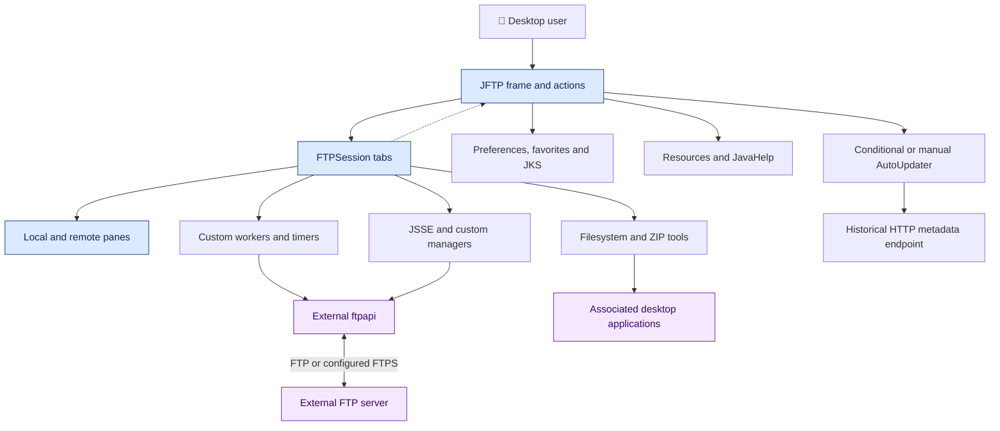
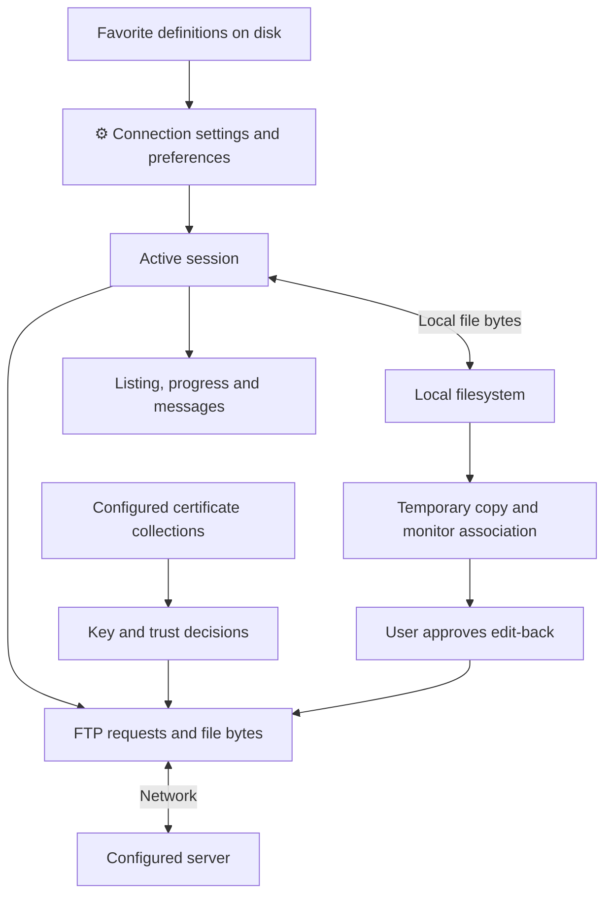
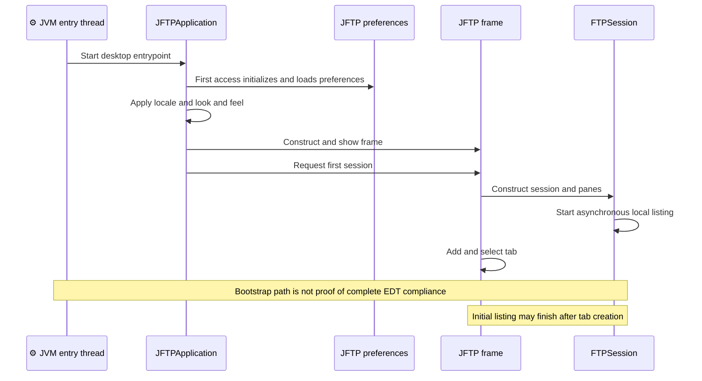

# ADR: jFTP — Main Architecture

**Date:** 2026-10-16 (documentation date, not the historical decision date).

**Status:** Accepted — retrospective baseline.

**PRD:** [Current functionality](../PRD.md). **Application source baseline:** `b5e7657bac97ae567533d74ae487e5ae713379c8`.

Accepted means that this records the existing architecture. It does not approve its suitability for modernization or authorize implementation changes.

---

## 1. Overview

This ADR set records jFTP's existing desktop architecture for the 21 stories and 12 flows in the PRD. The seven focused records separate decisions that can be revisited independently. It specifies no replacement architecture.

The separate [ADR-008 modernization proposal](008-modernization-roadmap.md) is for discussion. It does not supersede these observed decisions or authorize implementation. Source-audit corrections to the existing certificate contracts are recorded in ADR-003/004 and PRD 1.1.

| Record | Technical boundary | PRD coverage |
| --- | --- | --- |
| [001](001-desktop-ui-and-resources.md) | Swing workspace, localization, images, JavaHelp and information views | F01, F03, F09, F12 |
| [002](002-sessions-and-concurrency.md) | Session state, custom workers, callbacks and cancellation | F01–04, F07 |
| [003](003-ftp-and-ftps-integration.md) | Reflective client/parser, connection, transfers and commands | F02–04, F10–11 |
| [004](004-persistent-state-and-certificates.md) | Preferences, favorites, JKS and trust decisions | F08–10 |
| [005](005-files-archives-and-desktop-integration.md) | Filesystem operations, ZIP and associated applications | F03, F05–07 |
| [006](006-build-runtime-and-packaging.md) | Maven artifact, resources, runtime and assembly | F01, F12, packaging |
| [007](007-verification-baseline.md) | Characterization coverage and future verification gates | All flows and GAP-01–07 |

The [evidence ledger](baseline-evidence.md) records source correspondence, documentation lookups and unresolved findings. Existing [architecture views](../design/jftp-architecture-2026-10-15.md), [RepoMap](../repo-maps/README.md), [full-code Repomix](../RepoMix/README.md) and [graph guide](../code-graph/README.md) remain navigation/evidence sources, not runtime certification. Original generated snapshots are unchanged.

## 2. Technology Documentation References

IDs below were resolved and queried through Context7 for this task. Documentation describes platform/library contracts; repository evidence determines actual usage and pinned versions.

| Library / platform | Context7 ID or official docs | Used for |
| --- | --- | --- |
| Java SE 21 API | `/websites/oracle_en_java_javase_21_api` | Swing dispatch, Desktop, JSSE and resource-bundle contracts for the historically exercised runtime. |
| Java SE 8 API | `/websites/oracle_javase_8_api` | Serialization contract and legacy API reference, not evidence of a Java 8 runtime launch. |
| Maven | `/websites/maven_apache` | Lifecycle semantics, separate compile/test/package evidence. |
| Compiler Plugin | `/apache/maven-compiler-plugin` | Meaning of the configured release target. Application pins 3.13.0. |
| Surefire | `/websites/maven_apache_surefire_maven-surefire-plugin` | Test-phase/discovery reference. Current docs do not pin this project's effective plugin version. |
| JUnit legacy documentation | `/junit-team/junit4` — supplemental legacy TestCase articles only | Application depends on JUnit 3.8.1, not JUnit 4 annotations or Jupiter. No exact Context7 3.8.1 match was found. |
| ftpapi 3.0.0 | [Vendor documentation/downloads](https://www.jmethods.com/ftpapi/download.html) | Exact library coordinates and availability of API/source artifacts. No matching Context7 library was found. |
| JavaHelp | [Official project](https://javaee.github.io/javahelp/), [archived source](https://github.com/javaee/javahelp) | Help-system reference. The application pins 2.0.05; no Context7 match was found. |

## 3. System Architecture

### Architecture pattern

One Maven JAR runs a stateful Java/Swing desktop process. There is no separately deployed application backend, database service or LLM in the inspected application. FTP servers and desktop associations are external boundaries.

The package organization is not an enforced layered architecture. The frame owns sessions and sessions retain references back to the frame. Existing coupling is recorded rather than replaced with an invented acyclic dependency graph.

### Repository structure

| Path | Current role |
| --- | --- |
| `src/main/java` | Bootstrap, UI, actions, sessions, TLS, local utilities and ZIP implementation. |
| `src/test/java` | Four characterization suites and three fixture/probe helpers. |
| `src/main/resources`, `resources_de`, `resources_zh_TW` | Default and localized property resources under the main source tree. |
| `src/main/images`, `src/main/help` | Images and JavaHelp resources copied to the runtime classpath. |
| `src/main/assembly`, `src/main/scripts` | Assembly descriptors and launcher templates. |
| `pom.xml` | One `com.myjavaworld:jftp:5.0.2-SNAPSHOT` artifact, JAR packaging. |
| `docs` | Product/architecture records and immutable navigation snapshots. |
| `target` | Ignored build/runtime/verification output, not product source. |

The actual test root is `src/test/java`. The earlier instruction referring to `src/tests` is corrected with this documentation change; historical check commands are not silently reinterpreted.

### Technology stack

| Area | Technology | Observed role / consequence |
| --- | --- | --- |
| Desktop/UI | Java, Swing/AWT | Frame, dialogs, file tables, tabs and OS handoff within one process. |
| Task orchestration | In-repository custom SwingWorker and timers | Background operations with conditional EDT completion callbacks, not the JDK SwingWorker API. |
| Protocol | External ftpapi 3.0.0 | Reflectively selected FTP client and listing parser, plus event callbacks. |
| Secure transport | JSSE and custom key/trust managers | Uses configured JKS collections and interactive trust decisions. |
| Persistence | Java serialization and JKS files | User-local state, with format/credential limitations in ADR-004. |
| File tools | Local filesystem wrappers and in-repository ZIP utilities | Recursive operations and temporary copies, ADR-005. |
| Help | JavaHelp 2.0.05 | Locale-specific packaged help resources. |
| Build/testing | Maven, Compiler Plugin 3.13.0/release 8, JUnit 3.8.1 | Historical Windows build used JDK 21 and Maven 3.9.12; other runtime/package support is unverified. |

Historical reasons for the original technology selections are unknown unless a focused record cites an existing explanation.

## 4. Module Structure & Dependencies

| Responsibility grouping | Depends on | Consumers |
| --- | --- | --- |
| JFTPApplication / JFTP | Preferences, resources, Swing, session constructors | JVM entrypoint and user actions. |
| FTPSession | Frame reference, panes, worker, FTP client/parser, TLS and file utilities | Frame, action handlers, callbacks and monitors. |
| jftp.actions and dialogs | Active frame/session and selected files/settings | Menus, toolbar, pane actions and drag/drop. |
| jftp.ssl | JSSE, preferences and JKS manager | Secure-client initialization and certificate dialogs. |
| gui / util / zip | Java platform, filesystem and callbacks | Sessions, UI and actions. |
| External ftpapi / JavaHelp | Library internals outside application snapshots | Protocol and help adapters. |

These are source/package responsibilities, not separate Maven modules. Calls and shared mutable state cross the UI/orchestration boundary. Mutual frame/session references are an existing dependency limitation, not proof of an acyclic design.

## 5. Data Models

| Model | Key conceptual fields | Relationships and lifetime |
| --- | --- | --- |
| RemoteHost | Strings for host/login/account, integer ports, client/parser names, mode flags, command list and initial directories | Connection value used by a session; included in favorites. |
| Favorite | Named RemoteHost specialization | Ordered/sorted saved favorite list, reused across processes. |
| JFTPPreferences | Locale/UI, transfer mapping, connection/proxy settings, certificate paths/passwords, update flag | Global in-process aggregate, serialized across launches. |
| Session state | Client/parser, local/remote locations, filters, busy/abort/progress values | Mutable state owned by a tab, not a durable restored session. |
| File entry / monitor mapping | Path/name/type/size/date/attributes and temporary-to-remote mapping | Directory listing and session-local edit-back association. |
| Certificate collections | Aliases and certificates in configured JKS stores | Disk-backed client/server collections with static in-process caches. |

See ADR-004/005 for errors, formats and retention. Credentials can be included in serialized state; this is not a per-user secret vault.

## 6. API / Interface Contracts

The application exposes desktop actions rather than an HTTP service.

| Boundary | Input | Output | Errors / limits |
| --- | --- | --- | --- |
| Connection action | Approved RemoteHost, host/login/port validation | Attempted connection and initial listing | Reflection/configuration and login/listing errors have different cleanup paths. |
| Transfer action | Connected session, selection, destination and type | Protocol/file requests, progress and refresh | Per-file failures may permit continuation, no rollback contract. |
| Persistence | Preferences/favorite aggregate or certificate operation | User-local disk state and later load | Corruption behavior differs by store, writes are not claimed transactional. |
| Desktop/help | File or help-topic identifier | Associated app or help request | Platform resources/associations can be absent. |
| Worker/callback | Background operation and optional result | Normal completion posts UI callback | Unchecked worker failures can bypass completion. |

There are no documented application API rate limits or verified throughput/session ceilings. Reflective implementation names and resource keys are compatibility boundaries.

## 7. Environment Variables

| Variable | Purpose | Required | Example value |
| --- | --- | --- | --- |
| JAVA_HOME | Toolchain selection for the documented Maven procedure | Used by that procedure, not a mandatory application configuration variable | Path to the installed JDK. |
| PATH | Locate java/Maven tools when not invoked by absolute path | Operational convenience | Tool executable directories. |

No application-specific environment variable is required by the inspected desktop entry path. JVM `user.home` is a **system property**, not an environment variable: it determines `<user.home>/.jftp/data` when JFTP initializes. Set an isolated value before class initialization for synthetic verification. `jftp.qa.home` belongs to the test probe, not normal application configuration. Connection secrets are not sourced from environment variables by the inspected flow.

## 8. Technical Decisions

### D000-01 — Stateful desktop process and direct orchestration

**Status:** Accepted — retrospective baseline.

**Date:** 2026-10-16, recorded retrospectively.

**Context:** The existing UI, connection state and file actions execute within one JVM and one Maven artifact.

**Decision:** Record the Swing desktop and direct frame/session orchestration as the current system boundary.

**Rejected alternatives:** Historical rationale and rejected alternatives are not documented in the examined evidence.

**Consequences:**

- (+) Multiple site tabs can exist without a separately deployed application service.
- (-) Shared state and mutual UI/session references complicate isolation and concurrency reasoning.

**Review trigger:** Revisit when moving a flow outside the desktop process or changing session ownership.

### D000-02 — Separate observed architecture from modernization approval

**Status:** Accepted — retrospective baseline.

**Date:** 2026-10-16, recorded retrospectively.

**Context:** The PRD contains source-confirmed capabilities, historical executions and unresolved outcomes.

**Decision:** Use this set as a retrospective baseline, with focused decisions updated in place and dated history entries.

**Rejected alternatives:** Historical rationale and rejected alternatives are not documented in the examined evidence.

**Consequences:**

- (+) Future diffs can identify exactly which decision and PRD behavior changed.
- (-) Unknown historical rationale and runtime gaps remain explicit instead of being filled with assumptions.

**Review trigger:** Revisit the affected record when its storage, UI, execution, protocol or toolchain contract changes.

## 9. Diagrams

Edges in component/data views show dependencies or data movement, not guaranteed execution order. Sequence diagrams show inspected paths, with conditional completion.

### 9.1 Architecture / Component Diagram

[Rendered component SVG](diagrams/000-01.svg)

[Standalone Mermaid](diagrams/000-01.mmd)

### 9.2 Data Flow Diagram

[Standalone Mermaid](diagrams/000-02.mmd)

### 9.3 Sequence — startup and initial session (F01)

[Standalone Mermaid](diagrams/000-03.mmd)

## 10. Testing Strategy

### Philosophy

No new application tests are added or run for this documentation task. Existing historical checks and source observations stay separate from future validation targets. For future changes, apply the repository's characterization/TDD rules before production edits; do not assert green acceptance from compilation or source review.

### Test layers

| Layer | Type and scope | Current evidence / tools |
| --- | --- | --- |
| Unit | Connection settings and local filtering | Historical JUnit 3.8.1 suites. |
| Integration | Real local file persistence and later-process reload | Historical synthetic files and child JVM checks. |
| E2E | Real application and local FTP/FTPS service, persisted destination contents | Not demonstrated, no mocks or server selected here. |
| Manual desktop | Native controls, focus, cancellation, persistence and packaged launch | Historical startup only, complete flow QA remains incomplete. |

### Key scenarios

| Scenario | Input and expected observation | Boundary / status |
| --- | --- | --- |
| Existing behavior baseline | Four suites discover and execute 26 cases | Historical result only, ADR-007. |
| Source-to-record correspondence | Unchanged original source hashes and checked links | Documentation validation, not application acceptance. |
| Connection and transfer | Synthetic local server, successful and failing operations, destination inspection | Unexecuted future guardrail, PRD GAP-01–04. |
| UI/state compatibility | Saved synthetic state, native interaction and restart | Unexecuted future guardrail where not covered by existing suites. |

### Technical acceptance criteria

- **TAC-000-01 — Source:** module/package descriptions do not claim separately deployed services or enforced acyclic layers.
- **TAC-000-02 — Documentation:** all PRD flows F01–F12 map to a focused record and sequence coverage.
- **TAC-000-03 — Documentation:** every focused record separates historical execution, source evidence and unexecuted validation targets.
- **TAC-000-04 — Future guardrail, unexecuted:** an agreed modernization change passes its affected automated and real desktop/local-service checks before being declared runtime-complete.

## Change History

| Date | Change | Interpretation |
| --- | --- | --- |
| 2026-10-16 | Initial retrospective baseline. | Source observations and historical execution remain distinct. |

Future decisions update this file and add a dated history entry identifying changed decision IDs, rationale and affected PRD IDs. Git retains prior text; a new ADR number is not required merely to revise this area. No future architecture or test completion is implied by this baseline.
