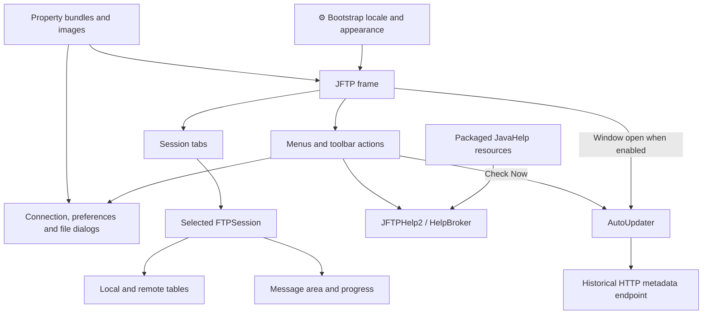
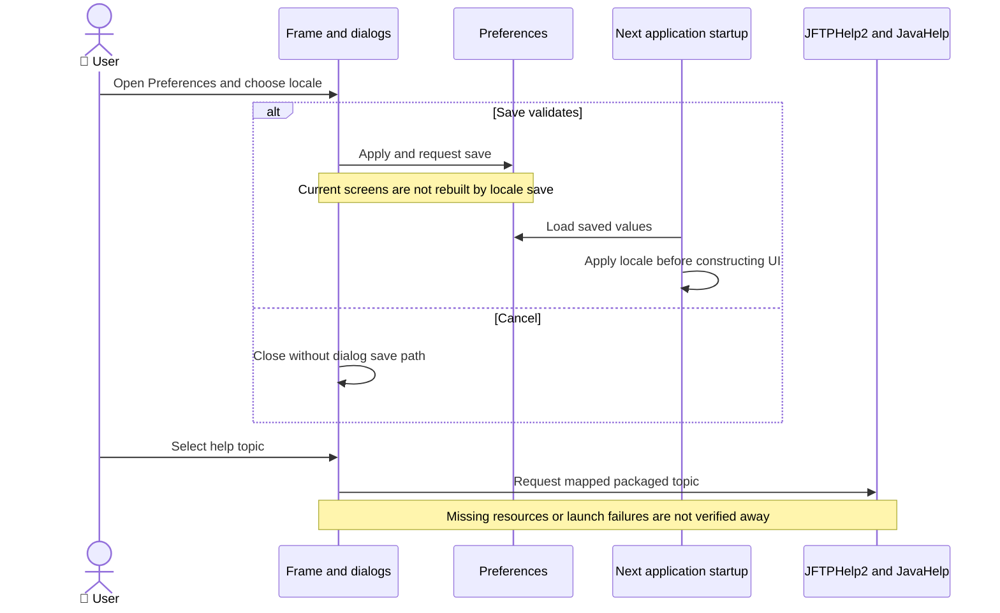
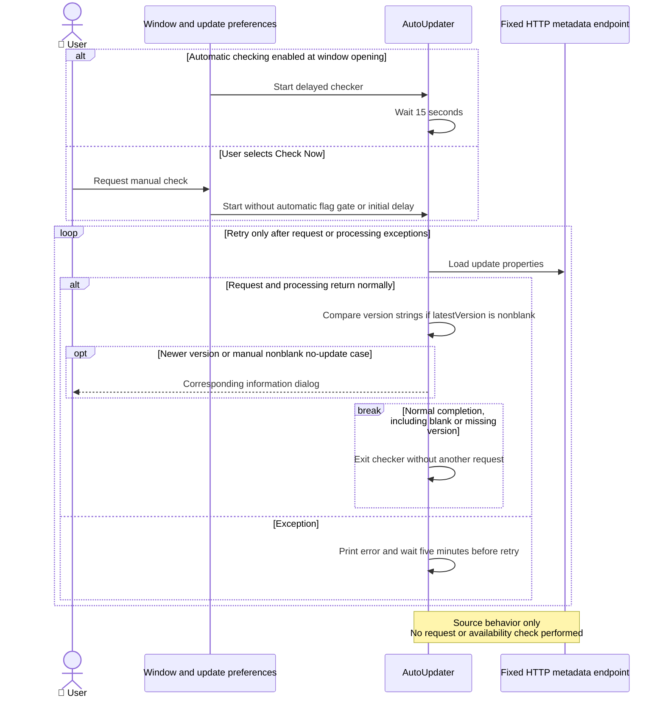

# ADR-001: Desktop UI and Resources

**Date:** 2026-10-16 (documentation date, not the historical decision date).

**Status:** Accepted — retrospective baseline.

**PRD:** [Current functionality](../PRD.md). **Application source baseline:** `b5e7657bac97ae567533d74ae487e5ae713379c8`.

**Relates to:** [000-main-architecture.md](000-main-architecture.md).

Accepted means that this records the existing architecture. It does not approve its suitability for modernization or authorize implementation changes.

---

## 1. Scope

The Swing workspace, actions/dialogs, locale/resource loading, JavaHelp and information views. Worker scheduling is ADR-002; protocol and persistence are ADR-003/004. Covers F01, F03, F09 and F12, especially US-01, US-05, US-18 and US-21.

## 2. Technology Documentation References

| Library | Context7 ID or official docs | Used for |
| --- | --- | --- |
| Java SE 21 | `/websites/oracle_en_java_javase_21_api` | Swing dispatch and PropertyResourceBundle contracts. |
| JavaHelp | [Official project](https://javaee.github.io/javahelp/) | Packaged helpsets; configured dependency is 2.0.05. |

## 3. Component Design

JFTPApplication loads preferences and applies locale/look and feel before constructing JFTP. The frame owns menu/toolbar actions and session tabs. FTPSession composes a status log above the local/remote horizontal split and a status bar below. Actions use the selected session and its current selection.

ResourceLoader delegates to ResourceBundle and image lookup; five resource roots are copied by Maven. JavaHelp opens locale-specific packaged helpsets through JFTPHelp2. Help topics, About and the update action are information entrypoints, not evidence that external content or the historical updater works.

AutoUpdater starts from window opening only when automatic checking is enabled, with an initial 15-second delay. Check Now starts it without that delay and independently of the automatic preference. It requests Java Properties from the fixed public endpoint `http://www.jMethods.com/software/jftp/update.properties`; no request was made in this task. A nonblank latestVersion is compared lexicographically to the product version. A newer string causes an information dialog including infoURL; an unchanged/older string can produce a no-update dialog for the manual path, while blank/missing version produces no dialog. Exceptions print a stack trace and retry after five minutes. No explicit updater cancellation path was found.

Swing's documented EDT contract is a platform reference. The original bootstrap and callbacks have not been proven to follow it consistently. The custom in-repository worker is not javax.swing.SwingWorker.

## 4. Data Structures

| Structure | Fields / lifetime |
| --- | --- |
| Session tab model | Active session and selected tab, in memory. |
| Directory table | File-entry array and sort column/direction, per pane. |
| Resource bundle | Locale-specific keys/messages, obtained at runtime. |
| UI preference subset | Locale/date-time and appearance settings, persisted by ADR-004. |
| Message document | Normal, command, reply, error, status and information content, bounded in memory. |
| Update metadata | latestVersion and infoURL strings loaded from the fixed public endpoint, not a semantic-version model. |

Existing language keys and resource bytes are compatibility data. English, German and Traditional Chinese resources are present; equivalent runtime translation coverage is unverified.

## 5. Interface Contracts

| Interface | Input | Output | Failure / boundary |
| --- | --- | --- | --- |
| Action dispatch | Active session and selection | Session operation or approved modal form | No active session/connection/selection can make an action return without work. |
| Table header click | Sortable column | Sorted listing with toggled direction | This is display ordering, not a server ordering guarantee. |
| Locale preference | Chosen locale | Saved choice applied at startup | No immediate rebuild of existing screens is established. |
| Resource lookup | Bundle/image name and locale | Resource for UI/help | Missing resource and packaging failures remain possible. |
| Help request | Topic ID | HelpBroker request | Resource/help launch availability unverified. |
| Update request | Automatic window-open flag or independent Check Now | Optional information/no-update dialog based on string comparison | Fixed HTTP metadata endpoint, missing-version silence, exception retry, no explicit cancellation path. |

## 6. Technical Decisions

### D001-01 — Swing frame, tabbed workspaces and action-driven dialogs

**Status:** Accepted — retrospective baseline.

**Date:** 2026-10-16, recorded retrospectively.

**Context:** The application exposes operations through menus, a toolbar, file panes and modal dialogs.

**Decision:** Record the existing frame/session composition and selection-based action dispatch.

**Rejected alternatives:** Historical rationale and rejected alternatives are not documented in the examined evidence.

**Consequences:**

- (+) One active workspace supplies the operation context and permits tab switching.
- (-) UI and operational orchestration are coupled, and full native behavior is not verified.

**Review trigger:** Revisit when changing navigation, modal flows, state ownership or the desktop framework.

### D001-02 — Packaged localized resources and JavaHelp

**Status:** Accepted — retrospective baseline.

**Date:** 2026-10-16, recorded retrospectively.

**Context:** Labels, images and help are loaded from additional classpath resource roots.

**Decision:** Preserve the observed resource/key paths and record locale application at startup.

**Rejected alternatives:** Historical rationale and rejected alternatives are not documented in the examined evidence.

**Consequences:**

- (+) Existing bundles and help remain addressable through their current names.
- (-) Resource decoding can depend on JDK version/configuration; behavior for every included bundle remains unverified.

**Review trigger:** Revisit when changing bundle encoding, locale-switching behavior, resource layout or the help system.

### D001-03 — Historical metadata updater

**Status:** Accepted — retrospective baseline.

**Date:** 2026-10-16, recorded retrospectively.

**Context:** Window opening and Check Now invoke a background checker with different delay/message options. It uses one hard-coded HTTP metadata source.

**Decision:** Record the existing trigger, string-version comparison and exception-retry behavior without treating service availability or updater shutdown as verified.

**Rejected alternatives:** Historical rationale and rejected alternatives are not documented in the examined evidence.

**Consequences:**

- (+) Manual checking can be requested independently of automatic checking.
- (-) Endpoint availability, lexicographic ordering, retry lifetime and metadata trust are not modernized or certified by this record.

**Review trigger:** Revisit when changing the update source, version ordering, retry/cancellation policy or update-message behavior.

## 7. Diagrams

### Component / data relationships

[Standalone Mermaid](diagrams/001-01.mmd)

### Sequence — locale, preferences and help (F09, F12)

[Standalone Mermaid](diagrams/001-02.mmd)

### Sequence — automatic and manual update checks (F12)

[Standalone Mermaid](diagrams/001-03.mmd)

## 8. Testing Strategy

No UI suite or complete native interaction pass is established. Historical startup demonstrates only a visible frame. The preference suite checks data persistence, not dialog behavior. Future UI changes require specification-based tests plus native manual QA; new scenarios below are not newly executed evidence.

| Scenario | Type | Input | Expected observation | Edge / evidence status |
| --- | --- | --- | --- | --- |
| Session navigation | Native manual | Two synthetic sessions | Correct tab, panes and action context | Close/switch/focus, unexecuted guardrail. |
| Form Save/Cancel | Unit/integration + native | Valid/invalid input | Existing approval/validation path | Do not treat model tests as dialog QA. |
| Locale and resources | Packaged/native | Saved locale, each included bundle | Startup applies locale and resource keys resolve | Encoding/missing resources, unexecuted. |
| Help/update entrypoints | Native/local prerequisites | Help IDs and update controls | Requests handled or observed errors recorded | No live updater availability claim. |
| Update-result and retry paths | Unit/integration characterization | Newer/older/blank version and request failure | String ordering, result-message conditions and retries observed | Unexecuted; no configurable local metadata endpoint is established, so do not substitute a mocked E2E pass. |

### Technical acceptance criteria

- **TAC-001-01 — Source:** UI documentation includes the message area above the local/remote split and status below it.
- **TAC-001-02 — Source:** locale application is described at startup rather than as immediate screen replacement.
- **TAC-001-03 — Future guardrail, unexecuted:** packaged verification resolves included help/images/bundles with their original paths and encodings.
- **TAC-001-04 — Future guardrail, unexecuted:** changed screens pass real native focus/navigation and success/cancel/error flows, with screenshots.
- **TAC-001-05 — Source:** Check Now is not gated by the saved automatic-update preference.
- **TAC-001-06 — Future guardrail, unexecuted:** changed update behavior distinguishes nonblank, blank/missing and failed metadata outcomes without treating string comparison as semantic versioning.

Source support: [PRD evidence E02, E04, E14, E17](../product/current-behavior-evidence.md), [architecture resources/startup](../design/jftp-architecture-2026-10-15.md), and [baseline ledger](baseline-evidence.md).

## Change History

| Date | Change | Interpretation |
| --- | --- | --- |
| 2026-10-16 | Initial retrospective baseline. | Source observations and historical execution remain distinct. |

Future decisions update this file and add a dated history entry identifying changed decision IDs, rationale and affected PRD IDs. Git retains prior text; a new ADR number is not required merely to revise this area. No future architecture or test completion is implied by this baseline.
