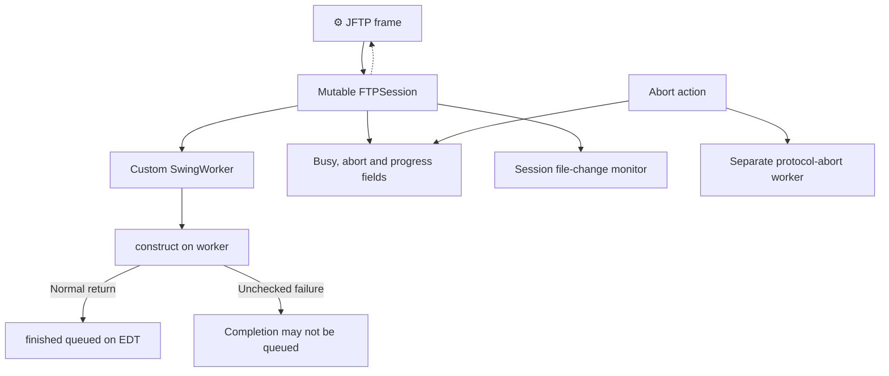
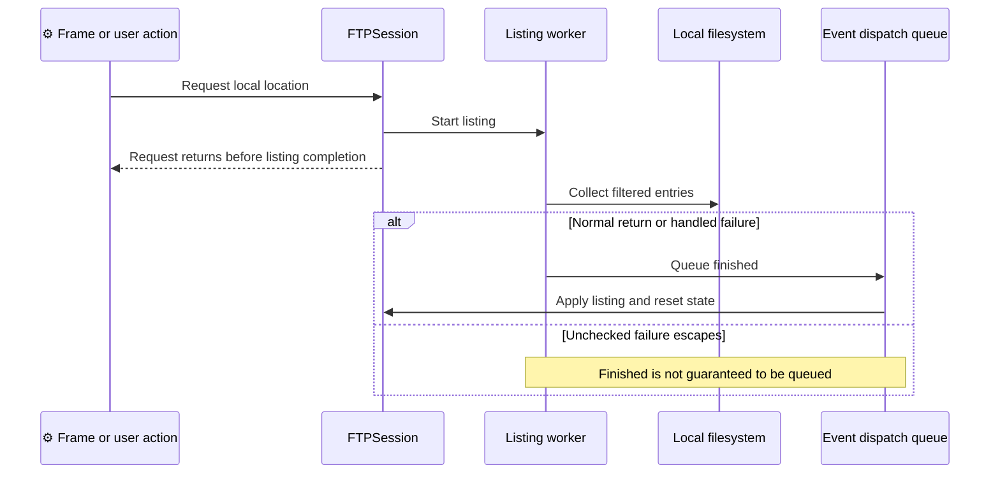
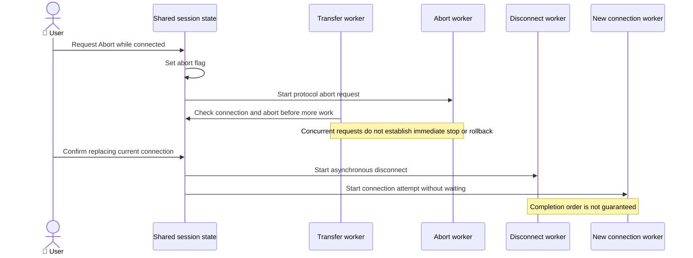

# ADR-002: Sessions and Concurrency

**Date:** 2026-10-16 (documentation date, not the historical decision date).

**Status:** Accepted — retrospective baseline.

**PRD:** [Current functionality](../PRD.md). **Application source baseline:** `b5e7657bac97ae567533d74ae487e5ae713379c8`.

**Relates to:** [000-main-architecture.md](000-main-architecture.md).

Accepted means that this records the existing architecture. It does not approve its suitability for modernization or authorize implementation changes.

---

## 1. Scope

Per-tab ownership, custom workers, listing completion, shared mutable progress/abort state, disconnect overlap and file-monitor lifetime. Protocol requests belong to ADR-003 and temporary-copy semantics to ADR-005. Covers F01–04 and the monitoring portion of F07.

## 2. Technology Documentation References

| Library | Context7 ID or official docs | Used for |
| --- | --- | --- |
| Swing / event queue | `/websites/oracle_en_java_javase_21_api` | EDT and asynchronous invokeLater contract only. |
| Custom worker | [Source-checked existing sequence](../design/jftp-architecture-2026-10-15.md) | In-repository SwingWorker has its own contract, not the JDK worker API. |

## 3. Component Design

Each FTPSession is a Swing panel owning a client/parser, current RemoteHost, local/remote locations, filters, panes and mutable operation state. The frame creates/selects/removes sessions; sessions retain a frame reference.

The custom SwingWorker executes construct work on a worker thread and posts finished through the Swing event queue after a normal return. Handled errors may still reach finished. An unchecked failure escaping construct can prevent posting finished. Not every callback/UI update has a proven thread contract.

Standard transfers iterate their captured selection serially and recurse through directories. No explicit application transfer queue was found in these inspected paths. A separate abort worker calls the protocol abort operation while a plain shared flag is checked by traversal. No visibility, immediate-stop or rollback guarantee is established.

Local listing is asynchronous. Starting it is not listing completion. Reconnect requests asynchronous disconnect and then another connection attempt without waiting for disconnect completion. Close Session has a distinct cleanup path and stops its file monitor.

## 4. Data Structures

| State | Owner / conceptual type | Lifetime / caveat |
| --- | --- | --- |
| Client, parser and host | References in one session | Mutated during connect/disconnect, no immutable session snapshot. |
| Current directories and filters | Per-session local/remote references | Reused by listings and recursive operations. |
| Busy / abort / progress | Booleans, byte/time counters | Shared mutable operation state, synchronization guarantees not established. |
| Worker result | Captured selection/listing | Used by normal completion callbacks. |
| Monitor registry | Temporary-file associations and timer | Timer begins after registration and stops on session close. |

## 5. Interface Contracts

| Boundary | Input | Output | Error / ordering |
| --- | --- | --- | --- |
| New session | Frame reference | Session with panes and initial local-list request | Listing may complete after the tab is selected. |
| Background construct | Operation and captured state | Normal result/handled failure | Unchecked failures can bypass finished. |
| Finished callback | Normally returned worker result | UI refresh/state reset through event queue | Not proof all follow-up work finished. |
| Abort | Connected session | Flag and separate protocol-abort request | Enabled even when no active transfer, no immediate-stop guarantee. |
| Reconnect | Current host definition and confirmation | Overlapping disconnect/connect requests | No enforced disconnect-completed-before-connect order. |

## 6. Technical Decisions

### D002-01 — Mutable per-tab sessions and custom background workers

**Status:** Accepted — retrospective baseline.

**Date:** 2026-10-16, recorded retrospectively.

**Context:** The session combines view coordination, client state and filesystem operations.

**Decision:** Record the custom construct/finished worker contract and per-tab mutable state as implemented.

**Rejected alternatives:** Historical rationale and rejected alternatives are not documented in the examined evidence.

**Consequences:**

- (+) Many operations execute outside their initial user action and can report progress.
- (-) Completion depends on return/error paths, and callback thread safety is not fully established.

**Review trigger:** Revisit when changing scheduling, worker implementation, state synchronization or tab ownership.

### D002-02 — Cooperative traversal abort plus separate protocol abort

**Status:** Accepted — retrospective baseline.

**Date:** 2026-10-16, recorded retrospectively.

**Context:** Transfers check session state while user Abort also starts a separate request.

**Decision:** Document cancellation as requests, without a rollback or completion-order guarantee.

**Rejected alternatives:** Historical rationale and rejected alternatives are not documented in the examined evidence.

**Consequences:**

- (+) Traversal can stop between eligible operations while a protocol abort is attempted.
- (-) Partial results can remain and async disconnect/reconnect can overlap.

**Review trigger:** Revisit when changing cancellation semantics, retry behavior or session cleanup.

## 7. Diagrams

### Component / state ownership

[Standalone Mermaid](diagrams/002-01.mmd)

### Sequence — asynchronous local listing (F01, F03)

[Standalone Mermaid](diagrams/002-02.mmd)

### Sequence — transfer abort and reconnect overlap (F02, F04)

[Standalone Mermaid](diagrams/002-03.mmd)

## 8. Testing Strategy

Current 26-case suites do not establish worker ordering, callback-thread correctness, cancellation timing or concurrent session isolation. Future behavior changes need tests exposing the agreed observable ordering, plus real native desktop/local-service checks. Do not silently replace the current race with a claimed fixed contract in this baseline.

| Scenario | Type | Input | Expected observation | Edge / evidence status |
| --- | --- | --- | --- | --- |
| Local listing completion | Integration + native | Readable/unreadable synthetic directory | Return vs callback ordering recorded | Slow listing and close, unexecuted. |
| Worker failure | Unit/integration | Normal, handled and unchecked failure | Document whether finished is queued | Avoid claiming universal cleanup, unexecuted. |
| Abort | Real local-service E2E + native | Multi-item/recursive transfer | Actual final contents and later work inspected | Partial results and inactive Abort, unexecuted. |
| Replace connection | Real local-service E2E | Connected session and reconnect | Actual overlap and final session state recorded | No assumed serial completion, unexecuted. |

### Technical acceptance criteria

- **TAC-002-01 — Source:** custom worker is distinguished from javax.swing.SwingWorker.
- **TAC-002-02 — Source:** initial listing and disconnect requests are not described as synchronous completion.
- **TAC-002-03 — Future guardrail, unexecuted:** worker/callback tests distinguish normal, handled-error and unchecked-failure paths.
- **TAC-002-04 — Future guardrail, unexecuted:** cancellation verification records actual destination contents and session state rather than a success/status message.

Source support: [architecture worker/connection/transfer views](../design/jftp-architecture-2026-10-15.md) and [PRD evidence E02–07, E12](../product/current-behavior-evidence.md).

## Change History

| Date | Change | Interpretation |
| --- | --- | --- |
| 2026-10-16 | Initial retrospective baseline. | Source observations and historical execution remain distinct. |

Future decisions update this file and add a dated history entry identifying changed decision IDs, rationale and affected PRD IDs. Git retains prior text; a new ADR number is not required merely to revise this area. No future architecture or test completion is implied by this baseline.
