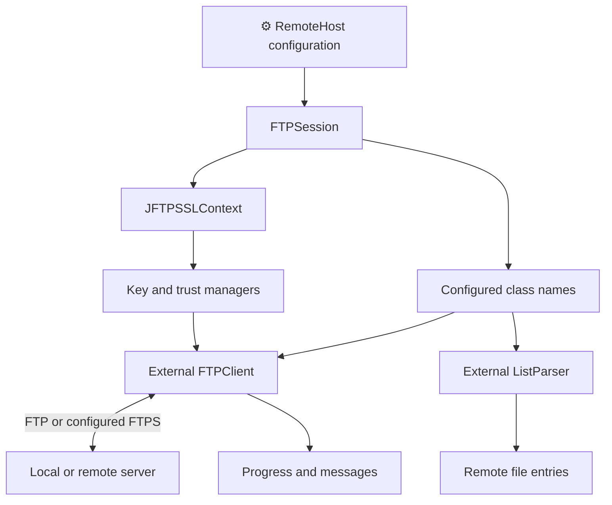
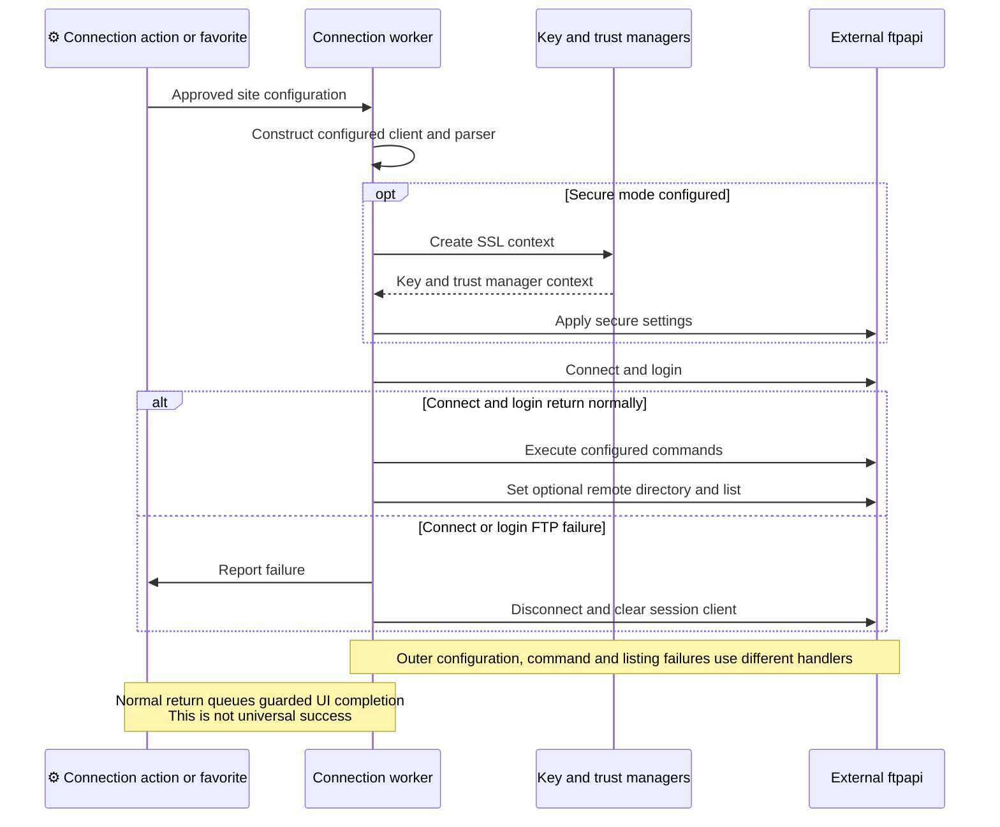
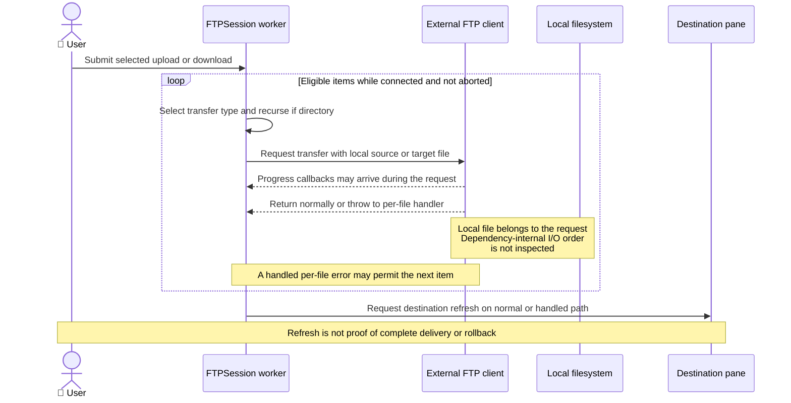
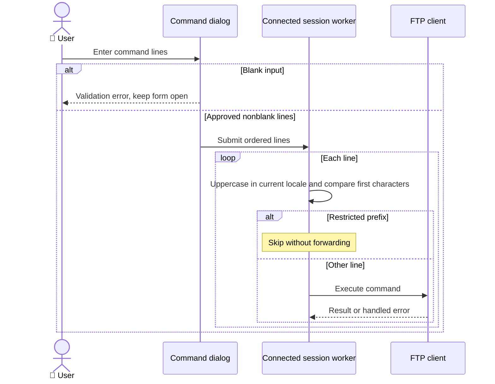

# ADR-003: FTP and FTPS Integration

**Date:** 2026-10-16 (documentation date, not the historical decision date).

**Status:** Accepted — retrospective baseline.

**PRD:** [Current functionality](../PRD.md). **Application source baseline:** `b5e7657bac97ae567533d74ae487e5ae713379c8`.

**Relates to:** [000-main-architecture.md](000-main-architecture.md).

Accepted means that this records the existing architecture. It does not approve its suitability for modernization or authorize implementation changes.

---

## 1. Scope

The external FTP client/list parser boundary, connection initialization, standard transfers, permission/command requests and JSSE wiring. Durable stores are ADR-004; local/ZIP/Desktop tools are ADR-005. Covers F02–04, F10–11 and US-02–09, US-14, US-19–20.

## 2. Technology Documentation References

| Library | Context7 ID or official docs | Used for |
| --- | --- | --- |
| ftpapi 3.0.0 | [Official vendor artifacts](https://www.jmethods.com/ftpapi/download.html) | Declared dependency and available exact-version API/source artifacts; no matching Context7 ID. |
| JSSE | `/websites/oracle_en_java_javase_21_api` | SSLContext, key and trust-manager roles. |

The vendor API HTML could not be retrieved during this task. Dependency internals and existing-destination semantics are not inferred from similarly named libraries or generic FTP documentation.

## 3. Component Design

RemoteHost contains client/parser implementation names. FTPSession constructs them reflectively, applies connection/security settings and listeners, then connects and logs in. After a normal login, it executes configured commands, optionally selects the initial remote directory and lists it.

Optional/explicit/implicit secure modes and data-channel encryption are configuration/wiring evidence. JFTPSSLContext supplies custom key/trust managers to the client. Successful FTPS negotiation, enabled protocol/cipher versions and server interoperability are not demonstrated.

Standard file actions snapshot selected entries, choose transfer type, process eligible directory children and request a destination refresh. Data/control/connection events feed messages/progress. Remote permissions are server-specific SITE CHMOD requests. Post-login commands and the interactive custom-command loop are distinct paths.

## 4. Data Structures

| Structure | Conceptual fields | Boundary |
| --- | --- | --- |
| RemoteHost | Host/login/account strings, ports, passive/security flags, implementation names, command array and initial paths | Serialized configuration, not a live connection. |
| Remote file | Path/name, kind, extension, size/date, attributes/owner/group | Produced by the selected parser/library. |
| Transfer selection | File entries, source/destination, chosen type | Snapshot traversed serially by the standard worker. |
| Events | Connection/control messages and byte counts | Callback threading is not fully established. |
| SSL context | Key manager and trust manager references | Configured from preference-selected stores. |

Passwords can be held as strings in connection definitions. No organization-account service or credential vault is introduced.

## 5. Interface Contracts

| Boundary | Input | Output | Failure / limit |
| --- | --- | --- | --- |
| Reflective construction | Configured class names | FTPClient and ListParser instances | Missing class, construction/type/configuration errors. |
| Connect/login | Host, normal/implicit port, user/password/account | Connected client on normal return | Inner FTP failure disconnects/clears client; later outer failures differ. |
| Post-login setup | Command order, optional remote path | Initial working directory/listing | Command/list errors can skip later steps without equivalent cleanup. |
| File transfer | Source, target, type and fixed call options | Library transfer request/events | Existing destination, resume/truncation and end-to-end contents remain unknown. |
| Interactive commands | Nonblank input lines | Ordered allowed command submissions | Current-locale uppercase prefix check silently skips listed commands. |
| Permissions | Path, permission mode, recursion flag | SITE CHMOD requests | Server support/authorization required. |
| Secure-client setup | Security flags and SSLContext | Configured client | Configuration is not proof of usable FTPS. |

The interactive skip prefixes are LIST, NLST, RETR, STOR, STOU, APPE, PASV, PORT, DATA, CWD and CDUP. They match from the first character of the uppercase line, not a parsed complete verb; leading whitespace and longer names therefore affect behavior.

## 6. Technical Decisions

### D003-01 — External reflectively selected protocol client and parser

**Status:** Accepted — retrospective baseline.

**Date:** 2026-10-16, recorded retrospectively.

**Context:** Protocol operations and remote listing types are supplied by ftpapi, outside the application's saved source pack.

**Decision:** Record ftpapi 3.0.0 and persisted implementation class names as the integration contract.

**Rejected alternatives:** Historical rationale and rejected alternatives are not documented in the examined evidence.

**Consequences:**

- (+) The current site configuration can select supplied implementations without changing action dispatch.
- (-) Renaming/replacing implementations can break saved definitions and runtime reflection.

**Review trigger:** Revisit when changing client/parser names, library version, supported protocol or connection initialization.

### D003-02 — JSSE context with application key and trust managers

**Status:** Accepted — retrospective baseline.

**Date:** 2026-10-16, recorded retrospectively.

**Context:** Configured secure connections use the application's stores and interactive trust path.

**Decision:** Record the configured context/manager boundary without certifying algorithms, host validation or interoperability.

**Rejected alternatives:** Historical rationale and rejected alternatives are not documented in the examined evidence.

**Consequences:**

- (+) Certificate decisions are connected to the application's own certificate collections and dialogs.
- (-) Trust overrides and modern JDK security settings require separate evidence before security claims.

**Review trigger:** Revisit when changing trust/identity policy, certificate storage or the runtime's transport capabilities.

## 7. Diagrams

### Component / data boundary

[Standalone Mermaid](diagrams/003-01.mmd)

### Sequence — connect and initialization errors (F02, F10)

[Standalone Mermaid](diagrams/003-02.mmd)

### Sequence — standard selection transfer (F04)

[Standalone Mermaid](diagrams/003-03.mmd)

### Sequence — interactive commands (F11)

[Standalone Mermaid](diagrams/003-04.mmd)

## 8. Testing Strategy

Configuration round trips are historically covered; no live FTP/FTPS transfer or certificate integration pass is claimed. Future changes need behavioral Red/Green for changed outcomes, protocol integration with real local components and native E2E with a real local server, zero E2E mocks and synthetic data. Server implementation/version is deliberately not selected by this baseline.

| Scenario | Type | Input | Expected observation | Edge / status |
| --- | --- | --- | --- | --- |
| Connection settings | Existing automated | Default/custom ports, commands, security values | Configuration preserved | Five historical cases, no network proof. |
| Initialization | Local-service integration/E2E | Valid, refused login, failing command/listing | Each error and cleanup path recorded | Unexecuted guardrail. |
| Transfer | Real local-service E2E | Binary/text, directory/filter, existing destination | Actual content and state inspected | GAP-01–02, unexecuted. |
| FTPS and permissions | Real local-service/native | Synthetic certificates, accepted/rejected trust, supported/unsupported CHMOD | Actual transport and permission outcomes recorded | GAP-03, unexecuted. |
| Interactive commands | Unit/integration | Restricted, longer, whitespace-prefixed lines and locales | Existing prefix behavior characterized | Unexecuted; distinguish post-login path. |

### Technical acceptance criteria

- **TAC-003-01 — Source:** client/parser names remain explicit reflection and saved-state compatibility boundaries.
- **TAC-003-02 — Source:** connect/login failures are distinguished from outer initialization failures.
- **TAC-003-03 — Future guardrail, unexecuted:** binary transfer verification compares actual source/destination contents.
- **TAC-003-04 — Future guardrail, unexecuted:** FTPS claims identify the real tested runtime/server and accepted/rejected certificate paths.

Source support: [PRD evidence E03, E06–08, E11, E15–16](../product/current-behavior-evidence.md) and [existing connection/transfer views](../design/jftp-architecture-2026-10-15.md).

## Change History

| Date | Change | Interpretation |
| --- | --- | --- |
| 2026-10-16 | Initial retrospective baseline. | Source observations and historical execution remain distinct. |

Future decisions update this file and add a dated history entry identifying changed decision IDs, rationale and affected PRD IDs. Git retains prior text; a new ADR number is not required merely to revise this area. No future architecture or test completion is implied by this baseline.
