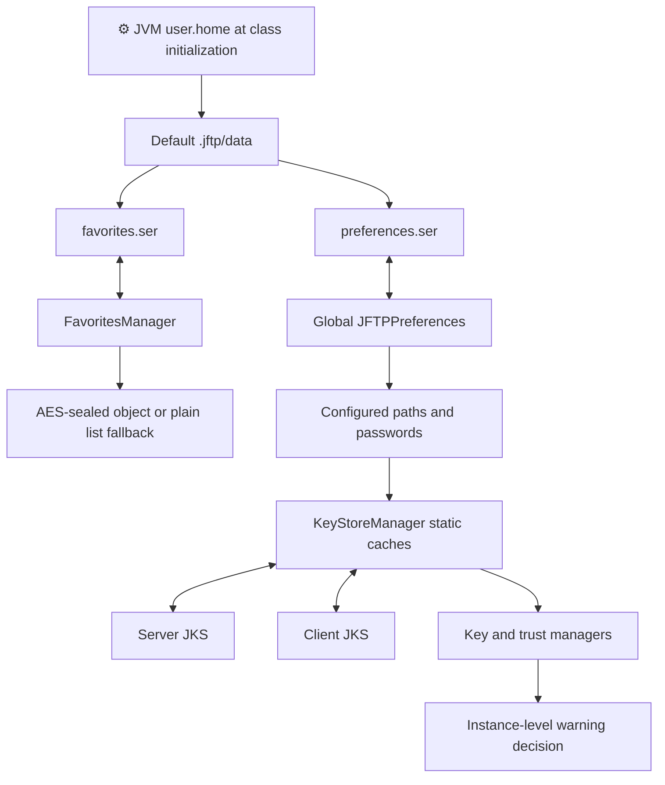
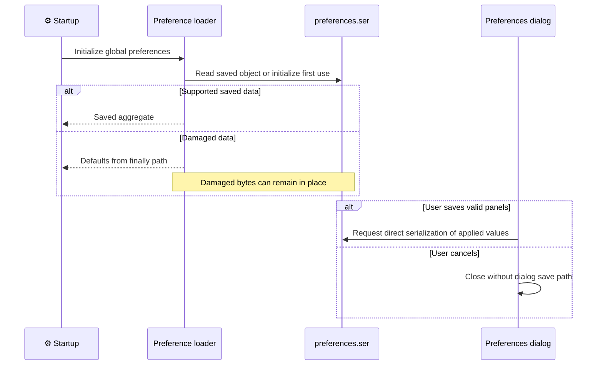
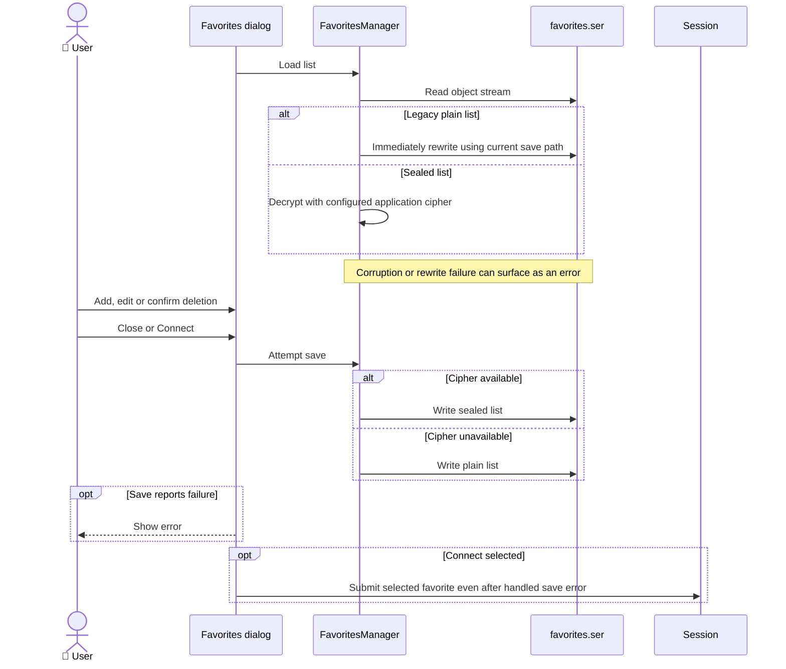

# ADR-004: Persistent State and Certificates

**Date:** 2026-10-16 (documentation date, not the historical decision date).

**Status:** Accepted — retrospective baseline.

**PRD:** [Current functionality](../PRD.md). **Application source baseline:** `b5e7657bac97ae567533d74ae487e5ae713379c8`.

**Relates to:** [000-main-architecture.md](000-main-architecture.md).

Accepted means that this records the existing architecture. It does not approve its suitability for modernization or authorize implementation changes.

---

## 1. Scope

Preference/favorite serialization, user data location, certificate collections and the trust decision's persistence boundary. Network negotiation is ADR-003; monitor temporary files are ADR-005. Covers F08–10 and US-17–19.

## 2. Technology Documentation References

| Library | Context7 ID or official docs | Used for |
| --- | --- | --- |
| Java object serialization | `/websites/oracle_javase_8_api` | Object stream and compatibility/error contracts. |
| JSSE / JKS | `/websites/oracle_en_java_javase_21_api` | SSLContext, key/trust managers and keystore APIs. |

Framework documentation does not establish that application writes are atomic, encrypted or recoverable.

## 3. Component Design

JFTP initializes a global JFTPPreferences aggregate and captures JVM user.home during class initialization. Default application data is `<user.home>/.jftp/data`. A later change to the property cannot relocate already initialized static paths.

Preferences are directly serialized into `preferences.ser`. Their loader starts with defaults and returns from a finally path that suppresses failures, so damaged bytes can remain while defaults are returned. No extra encryption wrapper protects serialized preference credentials.

FavoritesManager reads/writes `favorites.ser`. Older plain-list input is accepted and immediately rewritten. Save uses an AES-sealed object when cipher setup succeeds, with a plain-list fallback. The key is embedded in source rather than a per-user vault. Favorite definitions can contain password strings. No key/password values are reproduced in this ADR.

KeyStoreManager uses separately configured server/client JKS paths, with static in-process caches. Missing stores can be initialized and written empty. Add/delete mutate the cache before requesting save; a save failure can leave cache and disk different. Store exceptions reach callers, but some certificate deletion handlers only print errors to stderr. Paths can be outside the default data directory.

JFTPTrustManager initializes an X509 manager from the server store and delegates checkClientTrusted to it. Its checkServerTrusted path instead uses custom checks: leaf validity, exact case-insensitive subject-CN matching and whether a chain certificate has a store alias. It does not call the delegate's checkServerTrusted and has no SAN/wildcard branch in the inspected host check. Yes caches the chain in that instance without importing it.

The active CertificateManagerDlg has only the server tab; its client tab/builder are commented out. Client JKS path settings and key-manager use still exist. The warning's View action opens an installable CertificateDlg; Install requests adding the displayed chain and saving the server store separately from the later Yes/No choice. Save can fail. Ordinary manager details do not expose Install.

## 4. Data Structures

| Model | Fields / conceptual types | Persistence / lifetime |
| --- | --- | --- |
| JFTPPreferences | Locale, UI values, paths, transfer mapping, ports/flags, proxy identity, password character arrays, update state | Java object graph across launches, static current aggregate. |
| RemoteHost / Favorite | Named connection, integer ports, mode flags, commands, directory strings, password string | Serialized favorite list. Favorite names compare without case. |
| Favorite list | List of saved connection definitions | Reader accepts old list or sealed object; raw-list model is not a schema validator. |
| Server/client JKS | Aliases, certificate entries, configured path/password; client JKS may also contain externally provisioned private-key entries | Disk files plus static caches. Existing certificate aliases can be replaced. The active UI imports certificate entries, not private keys. |
| Accepted chain | Certificate chain reference | Trust-manager instance only, not durable import. |

Fixed serialization identifiers exist, but compatibility beyond observed supported inputs and historical suites is not established. There is no database schema, transactional storage engine or automatic per-user credential protection.

## 5. Interface Contracts

| Boundary | Input | Output | Failure / compatibility |
| --- | --- | --- | --- |
| Preference save | Current preference aggregate | Direct overwrite of serialized file | No atomic-write/recovery guarantee. |
| Preference load | Existing bytes or first use | Saved values or defaults | Corrupt data can remain while defaults are returned. |
| Favorite load | Legacy list or sealed favorite data | List of definitions | Legacy rewrite can itself fail; damaged stream errors propagate to UI handlers. |
| Favorite save | Current list | Sealed or plain object stream | UI reports save failure but may still close/connect. |
| Certificate manager add/delete | Server collection and certificate/alias | Cached mutation followed by save attempt | Only server tab active; save failure has no cache rollback and some delete errors only reach stderr. |
| Trust warning Yes/No | Chain and failed check | Instance-level acceptance or exception | Yes itself does not import a certificate. |
| Warning certificate view Install | Displayed chain and explicit Install | Request persistent server-store import | Independent of the warning's later Yes/No; no automatic rollback on No. |

## 6. Technical Decisions

### D004-01 — Separate serialized preferences and favorites

**Status:** Accepted — retrospective baseline.

**Date:** 2026-10-16, recorded retrospectively.

**Context:** The application stores global settings separately from reusable site definitions.

**Decision:** Record the current object formats, paths, legacy read/rewrite and asymmetric corruption behavior.

**Rejected alternatives:** Historical rationale and rejected alternatives are not documented in the examined evidence.

**Consequences:**

- (+) Saved definitions and settings can be reused by later processes with existing supported formats.
- (-) Direct serialization couples stored data to Java models and does not provide transactional recovery or a credential vault.

**Review trigger:** Revisit before changing serializable classes, stored formats, credential handling or the data-home location.

### D004-02 — Separate JKS collections with instance-level warning overrides

**Status:** Accepted — retrospective baseline.

**Date:** 2026-10-16, recorded retrospectively.

**Context:** TLS identity/trust managers consume configurable client/server collections.

**Decision:** Record JKS persistence independently from temporary trust-warning acceptance.

**Rejected alternatives:** Historical rationale and rejected alternatives are not documented in the examined evidence.

**Consequences:**

- (+) Certificate-management operations and interactive decisions have distinct lifetimes.
- (-) Static caches, serialized store passwords and nonpersistent overrides limit stronger security/durability claims.

**Review trigger:** Revisit when changing certificate format, cache lifetime, trust overrides or key/password management.

## 7. Diagrams

### Component / persistent data flow

[Standalone Mermaid](diagrams/004-01.mmd)



### Sequence — preference load/save (F09)

[Standalone Mermaid](diagrams/004-02.mmd)



### Sequence — favorite load/save and connection (F08)

[Standalone Mermaid](diagrams/004-03.mmd)



### Sequence — certificate management and trust warning (F10)

[Standalone Mermaid](diagrams/004-04.mmd)

```mermaid
sequenceDiagram
    actor User as 👤 User
    participant Dialog as Server certificate manager
    participant Stores as Cached JKS manager
    participant Disk as Configured JKS file
    participant Trust as Trust-manager instance
    participant Details as Warning certificate view
    User->>Dialog: Import or confirm deletion
    Dialog->>Stores: Modify server collection
    Stores->>Disk: Attempt save after cache mutation
    Note over Stores,Disk: Save failure can leave cache and disk different<br/>Not every deletion error is shown in a dialog
    Trust->>Stores: Obtain trust collection
    Trust->>Trust: Custom leaf-validity,<br/>CN and alias checks
    Note over Trust: No delegate server-chain<br/>validation call
    opt Check leads to warning
        Trust-->>User: Show warning
        opt User selects View Certificate
            User->>Details: Inspect chain
            opt User selects Install
                Details->>Stores: Add chain to server collection
                Stores->>Disk: Attempt persistent save
            end
        end
        alt User accepts
            Trust->>Trust: Cache accepted chain<br/>for this instance
            Note over Trust,Disk: This acceptance path<br/>does not import a certificate
        else User rejects
            Trust->>Trust: Fail trust check
        end
    end
```

## 8. Testing Strategy

Historical persistence suites cover favorites/preferences, synthetic first use, saved values, cross-process reads, legacy favorite lists and damaged data. No JKS/import/trust-warning suite or full native save/restart proof is established. Future storage changes require preservation characterization and an explicitly agreed migration before altering formats.

| Scenario | Type | Input | Expected observation | Edge / status |
| --- | --- | --- | --- | --- |
| Preferences/favorites reload | Existing integration | Synthetic saved state and child JVM | Existing values restored | Historical suites, not a new run. |
| Corrupt/legacy data | Existing integration | Invalid streams or supported older list | Defaults vs error/rewrite as recorded | Historical behavior, not endorsed recovery. |
| Write failure | Integration/native | Unwritable synthetic target | Actual error and later close/connect behavior recorded | Unexecuted guardrail. |
| JKS changes | Integration/native | Synthetic certificates and temp collections | Import/details/delete and persisted state inspected | Missing/corrupt stores and alias replacement, unexecuted. |
| Trust decision | Real local FTPS/native | Synthetic chain and Yes/No/View/Install | Transient Yes vs explicit persistent Install inspected | Install then No, failed save, no mock E2E; unexecuted. |

### Technical acceptance criteria

- **TAC-004-01 — Historical automated:** later-process checks restore the recorded preference/favorite values for supported synthetic inputs.
- **TAC-004-02 — Source:** documentation does not claim unconditional encrypted favorites or encrypted preference credentials.
- **TAC-004-03 — Source:** warning acceptance is distinct from certificate import and permanent collection mutation.
- **TAC-004-04 — Future guardrail, unexecuted:** format/credential changes identify compatibility or migration outcomes for existing synthetic saved state.

Source support: [PRD evidence E05, E13–15](../product/current-behavior-evidence.md) and [persistence architecture](../design/jftp-architecture-2026-10-15.md).

## Change History

| Date | Change | Interpretation |
| --- | --- | --- |
| 2026-10-16 | Initial retrospective baseline. | Source observations and historical execution remain distinct. |
| 2026-10-16 | Correct active certificate UI, warning Install and custom server-validation description. | Deeper source audit, not an architectural implementation change. |

Future decisions update this file and add a dated history entry identifying changed decision IDs, rationale and affected PRD IDs. Git retains prior text; a new ADR number is not required merely to revise this area. No future architecture or test completion is implied by this baseline.
