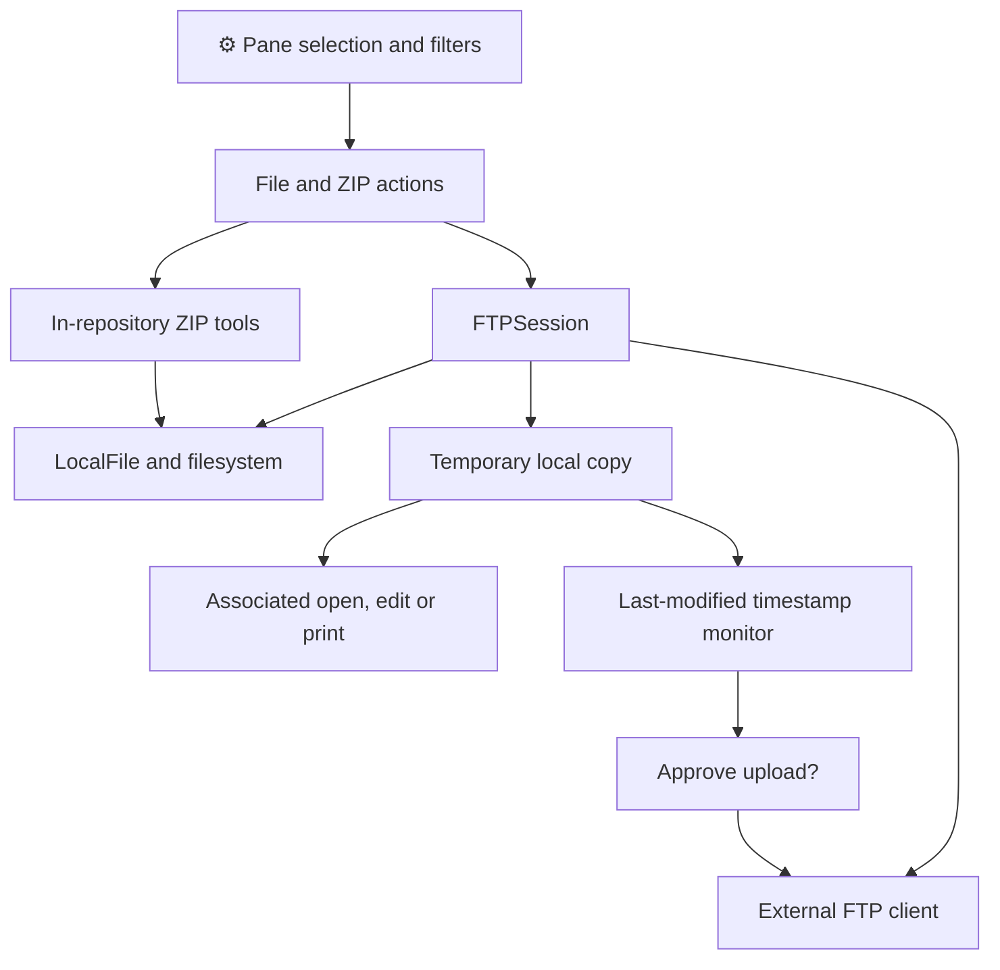
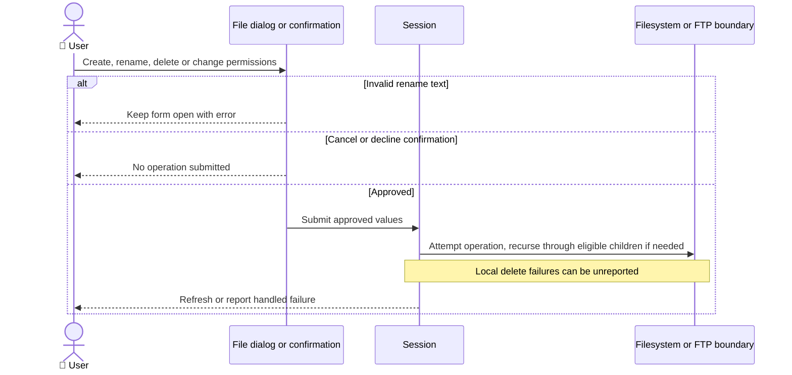
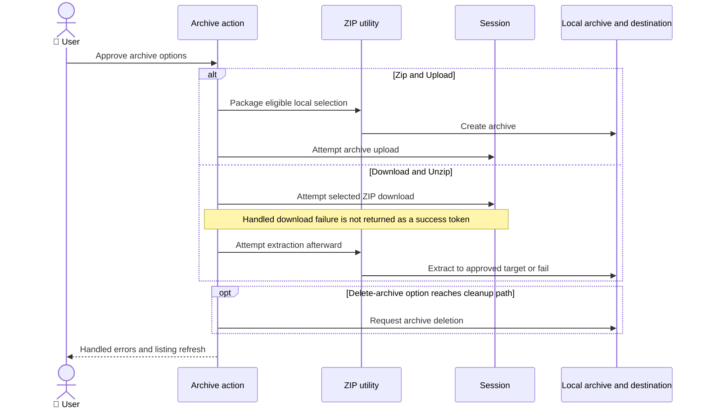
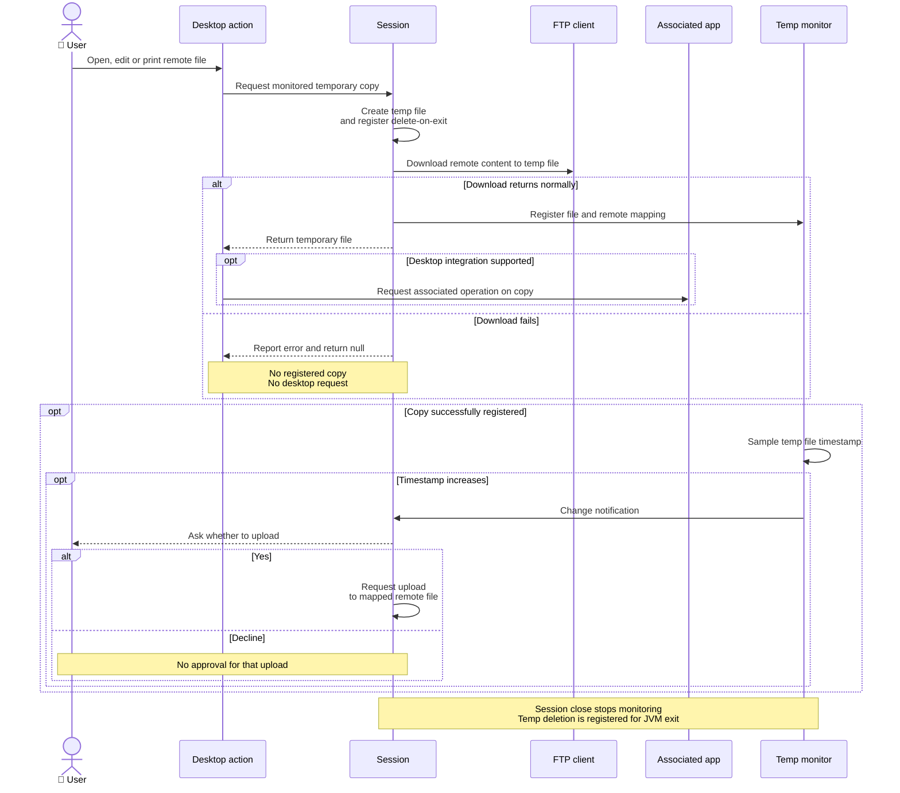

# ADR-005: Files, Archives and Desktop Integration

**Date:** 2026-10-16 (documentation date, not the historical decision date).

**Status:** Accepted — retrospective baseline.

**PRD:** [Current functionality](../PRD.md). **Application source baseline:** `b5e7657bac97ae567533d74ae487e5ae713379c8`.

**Relates to:** [000-main-architecture.md](000-main-architecture.md).

Accepted means that this records the existing architecture. It does not approve its suitability for modernization or authorize implementation changes.

---

## 1. Scope

Local/remote file-operation coordination, filters, ZIP actions, associated desktop applications and temporary-copy monitoring. FTP mechanics are ADR-003 and worker ordering ADR-002. Covers F03, F05–07 and US-05–06, US-10–16.

## 2. Technology Documentation References

| Library | Context7 ID or official docs | Used for |
| --- | --- | --- |
| Java file/Desktop APIs | `/websites/oracle_en_java_javase_21_api` | Filesystem and associated application boundary. |
| In-repository file/ZIP utilities | [Existing source evidence](../product/current-behavior-evidence.md) | Actual utility/action wiring, no third-party ZIP replacement is selected. |

## 3. Component Design

FTPSession coordinates pane selection and local/remote file operations. LocalFile wraps filesystem entries. Local and remote filters influence listings and eligible descendants for transfers, deletion and recursive permission changes. Local directories remain navigable.

Create/rename/delete actions use dialog approval or confirmation. Rename accepts nonblank source/destination text, including paths, without a dedicated move chooser. Actual cross-directory success is platform/server-dependent. Local recursive deletion ignores individual failure return values.

Zip and Upload creates a local archive from eligible selection and attempts upload. Download and Unzip attempts download, then extraction without requiring a success result from that download. Optional archive deletion and pane refresh do not certify successful content delivery.

Local open/edit/print requests the corresponding java.awt.Desktop operation when desktop integration is supported. Remote versions obtain a temporary local copy first and register it for monitoring. FileChangeMonitor uses last-modified timestamp increases at one-second sampling, not content hashing. Detected changes prompt for upload; Yes approves the upload request.

Temporary copies are registered for deletion at JVM exit. Scoped close paths stop monitoring and clear session state but do not establish immediate temporary-file deletion. No conflict-resolution or automatic synchronization contract is present.

## 4. Data Structures

| Structure | Conceptual fields / relationships | Lifetime |
| --- | --- | --- |
| Local/remote entry | Name/path, extension/type, size/date and attributes | Listing/operation value. |
| Filter | Name/date conditions, local hidden-file and inclusion/exclusion flags | Per-session, reused during recursive child enumeration. |
| ZIP options | Archive path, remote name or extraction target, delete-archive flag | One approved action. |
| Temporary mapping | Temp local file, remote file/destination, upload direction | Session-local monitor association. |
| Monitor sample | File and last observed modification timestamp | Sampling state, begins when a file is registered. |

## 5. Interface Contracts

| Operation | Input | Output | Error / caveat |
| --- | --- | --- | --- |
| Create/rename | Approved names/path text | Filesystem or protocol request | Blank rename rejected, actual move result unverified. |
| Delete | Selection and confirmation | Filtered recursive deletion attempts | Filtered children can remain; local individual failure may not be reported. |
| ZIP upload | Selected local files and archive options | Archive then upload attempt | Handled errors can coexist with cleanup/refresh. |
| Download/unzip | Selected remote ZIP and approved options | Download/extraction attempts | Extraction can follow failed download, no success token gates it. |
| Desktop action | Supported desktop, regular file | Associated app request | Association/launch failures can surface; unsupported desktop may no-op. |
| Monitor notification | Increased modification timestamp | Upload decision for mapped remote file | Editor replacement/mtime behavior, concurrent remote edits and missed changes unverified. |

## 6. Technical Decisions

### D005-01 — Shared filtered file-operation paths and in-repository ZIP tools

**Status:** Accepted — retrospective baseline.

**Date:** 2026-10-16, recorded retrospectively.

**Context:** The UI dispatches file/ZIP tasks through actions and FTPSession rather than a separately deployed file service.

**Decision:** Record the current wrappers, recursive filtering and action-specific error/cleanup paths.

**Rejected alternatives:** Historical rationale and rejected alternatives are not documented in the examined evidence.

**Consequences:**

- (+) The current selection and filters can be reused for several operations.
- (-) Recursive operations may omit filtered descendants and cleanup does not prove success.

**Review trigger:** Revisit when changing filter semantics, recursive traversal, archive handling or destination-conflict behavior.

### D005-02 — Associated desktop applications with monitored remote temporary copies

**Status:** Accepted — retrospective baseline.

**Date:** 2026-10-16, recorded retrospectively.

**Context:** Remote content is downloaded locally before open/edit/print and can later be offered for upload.

**Decision:** Record timestamp-based monitoring and explicit user-approved edit-back.

**Rejected alternatives:** Historical rationale and rejected alternatives are not documented in the examined evidence.

**Consequences:**

- (+) Existing editors/printers can be requested without embedding a document editor.
- (-) Behavior depends on OS associations and timestamps, with no remote conflict detection or immediate cleanup guarantee.

**Review trigger:** Revisit when changing temp-file retention, monitoring, editor integration or synchronization semantics.

## 7. Diagrams

### Component / file data flow

[Standalone Mermaid](diagrams/005-01.mmd)

### Sequence — file maintenance (F06)

[Standalone Mermaid](diagrams/005-02.mmd)

### Sequence — archive variants (F05)

[Standalone Mermaid](diagrams/005-03.mmd)

### Sequence — remote edit and save-back (F07)

[Standalone Mermaid](diagrams/005-04.mmd)

## 8. Testing Strategy

Local filtering has historical real-file characterization. File mutation, archives, native Desktop integration and edit-back lack complete application-flow verification. Future changes need meaningful behavior tests, real local fixtures and native manual/E2E flows; these are unexecuted guardrails, not existing successes.

| Scenario | Type | Input | Expected observation | Edge / status |
| --- | --- | --- | --- | --- |
| Local filter | Existing unit/integration | Real synthetic files, dates, hidden attributes | Inclusion/exclusion and navigation as recorded | Historical seven cases. |
| File maintenance | Local integration + native/local server | Create/rename/delete/properties | Actual entry/state outcome inspected | Cancellation, filtered children, failed local delete, unexecuted. |
| Archive actions | Integration + real-service E2E | Synthetic ZIP/content and destinations | Real archive/destination contents inspected | Failed download before extraction and cleanup, unexecuted. |
| Desktop/edit-back | Native manual + real-service E2E | Actual editor, synthetic remote copy | Prompt, accepted/declined upload and remote contents inspected | mtime behavior, unsupported desktop, concurrent edits, unexecuted. |

### Technical acceptance criteria

- **TAC-005-01 — Historical automated:** local filter characterization includes navigable directories and real synthetic file conditions.
- **TAC-005-02 — Source:** archive extraction is not described as gated on verified download success.
- **TAC-005-03 — Source:** monitoring is described as timestamp sampling rather than content synchronization.
- **TAC-005-04 — Future guardrail, unexecuted:** changed file/archive/edit-back flows verify actual local and remote destination contents after success, cancellation and failure.

Source support: [PRD evidence E04–05, E09–12, E18](../product/current-behavior-evidence.md) and [baseline ledger](baseline-evidence.md).

## Change History

| Date | Change | Interpretation |
| --- | --- | --- |
| 2026-10-16 | Initial retrospective baseline. | Source observations and historical execution remain distinct. |

Future decisions update this file and add a dated history entry identifying changed decision IDs, rationale and affected PRD IDs. Git retains prior text; a new ADR number is not required merely to revise this area. No future architecture or test completion is implied by this baseline.
