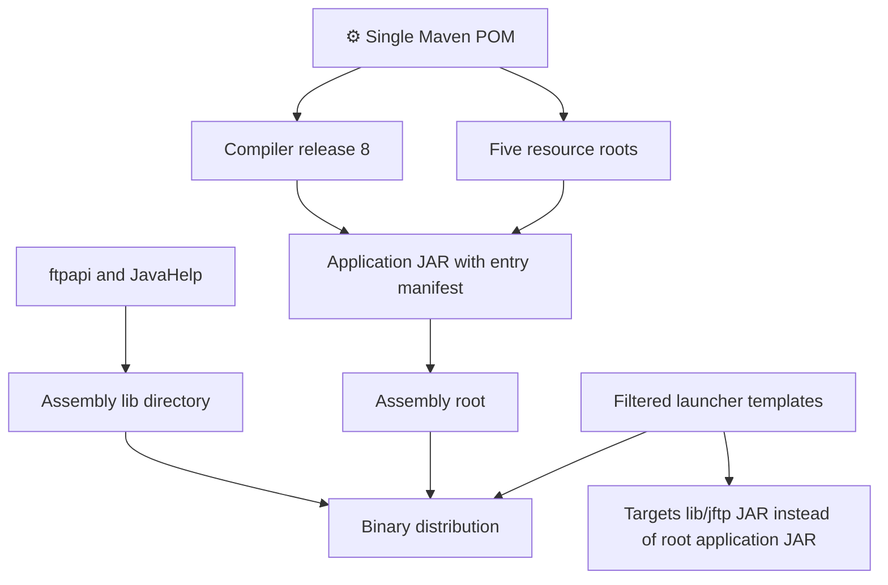
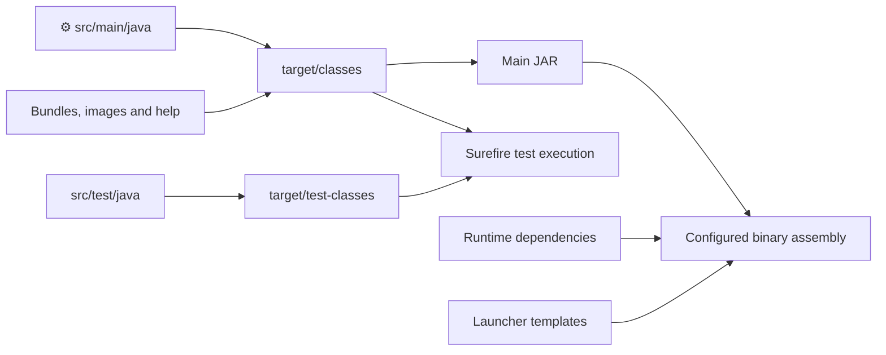
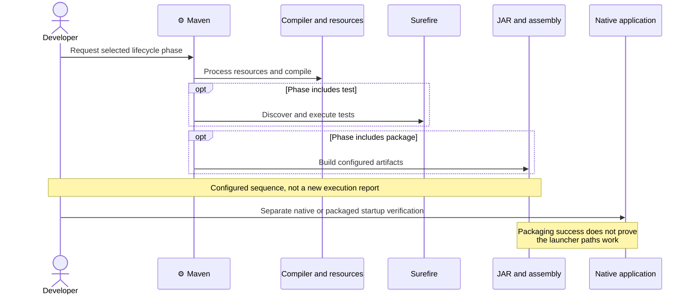

# ADR-006: Build, Runtime and Packaging

**Date:** 2026-10-16 (documentation date, not the historical decision date).

**Status:** Accepted — retrospective baseline.

**PRD:** [Current functionality](../PRD.md). **Application source baseline:** `b5e7657bac97ae567533d74ae487e5ae713379c8`.

**Relates to:** [000-main-architecture.md](000-main-architecture.md).

Accepted means that this records the existing architecture. It does not approve its suitability for modernization or authorize implementation changes.

---

## 1. Scope

The Maven build, Java target/runtime distinction, dependencies, resource assembly and launcher templates. It records a source-level packaging mismatch without repairing it. Covers startup/resource prerequisites for F01/F12 and the packaging verification boundary.

## 2. Technology Documentation References

| Library | Context7 ID or official docs | Used for |
| --- | --- | --- |
| Maven | `/websites/maven_apache` | Lifecycle and packaging semantics, not project-specific effective versions. |
| Compiler Plugin | `/apache/maven-compiler-plugin` | Release setting; configured version 3.13.0. |
| Java SE | `/websites/oracle_en_java_javase_21_api` | Runtime/library contracts. |

## 3. Component Design

The single Maven JAR is `com.myjavaworld:jftp:5.0.2-SNAPSHOT`. Production and tests use the conventional `src/main/java` and `src/test/java` roots. There is no project Maven wrapper or separate UI/protocol build module.

Declared dependencies are ftpapi 3.0.0 and JavaHelp 2.0.05 with compile scope, and JUnit 3.8.1 with test scope. The runtime resource roots are the default, German and Traditional Chinese bundles, images and help under `src/main`.

Compiler Plugin 3.13.0 sets release 8. Historical verification used Microsoft JDK 21.0.10 and Maven 3.9.12. The compiler target is not evidence of successful runtime execution on Java 8 or other platforms. The Windows profile excludes only OSXAdapterOld.java, leaving the reflective active adapter design intact.

The JAR manifest declares JFTPApplication and a lib-prefixed dependency classpath. Assembly single is bound to package and is configured to produce ZIP/directory/tar.gz outputs. The binary descriptor puts the application JAR at the assembly root and dependencies in lib. The supplied launcher templates instead target the application JAR inside lib. This is a static mismatch; no packaged launch or repair is claimed.

### Explicitly configured build tools

| Tool | Version / role |
| --- | --- |
| Compiler | 3.13.0, release 8. |
| JAR | 2.4, manifest main class and dependency classpath prefix. |
| Source | 2.1.2, source artifact handling. |
| Assembly | 2.3, package-bound distribution descriptors. |
| SCM / deploy / release | 1.7 / 2.7 / 2.3, historical publishing configuration. |
| Wagon FTP extension | 2.2, build publishing transport configuration, not desktop application FTP behavior. |
| Surefire | Not explicitly pinned in this POM; historical logs show 3.2.5 and JUnit3Provider. |

These entries describe configuration. No publishing lifecycle, dependency upgrade or application deployment is authorized by this record.

## 4. Data Structures

| Artifact | Contents / location | Evidence limit |
| --- | --- | --- |
| Application JAR | Compiled classes, copied resources and entry manifest | Current packaging configuration, not a newly built artifact. |
| Binary assembly | Root application JAR, lib dependencies, docs and filtered launcher scripts | Root/lib launcher mismatch remains. |
| Source archive | Project sources according to existing plugin configuration | No current release certification. |
| User state | Determined by JVM user.home, outside artifact | Must be isolated before application class initialization for QA. |

## 5. Interface Contracts

| Boundary | Input | Output | Failure / constraint |
| --- | --- | --- | --- |
| Maven compile | Compatible JDK, repository dependencies and sources | Compiled main classes | Not evidence tests ran or app starts. |
| Maven test | Compiled tests and synthetic profile fixtures | Discovered/executed test report | Zero tests is not a pass. |
| Package | JAR/resources/dependencies/scripts | Configured assembly artifacts | Layout and launcher validity require separate proof. |
| Desktop entry | Classpath or valid manifest distribution | Visible window and initial session | Native desktop/resources required. |
| JAVA_HOME / PATH | Operational tool locations | Tool selection | Not app-specific required environment variables. |
| JVM user.home | Synthetic or real profile path | Static data-root capture | Later changes cannot relocate initialized paths. |

No fixed test-machine paths or temporary Maven settings are portable application requirements. The exact historical commands and proxy/cache paths remain in [startup verification](../minimal-startup.md).

## 6. Technical Decisions

### D006-01 — Single Maven artifact with explicit resource roots and assembly

**Status:** Accepted — retrospective baseline.

**Date:** 2026-10-16, recorded retrospectively.

**Context:** The application packages code, localized bundles, images and help together and depends on two external runtime libraries.

**Decision:** Record the current JAR/assembly layouts and manifest contract, including the unverified launcher mismatch.

**Rejected alternatives:** Historical rationale and rejected alternatives are not documented in the examined evidence.

**Consequences:**

- (+) The source describes both dependency classpath and included runtime resources.
- (-) An assembly configuration is not proof the supplied launcher reaches the correct JAR or that resources load on all platforms.

**Review trigger:** Revisit when changing resource roots, dependency scope, main class, assembly paths or launcher packaging.

### D006-02 — Minimal recorded Windows build repair and release-8 target

**Status:** Accepted — retrospective baseline.

**Date:** 2026-10-16, recorded retrospectively.

**Context:** The startup record documents JDK 21 rejecting the previous source/target 1.5 and missing direct Apple API classes on Windows.

**Decision:** Record Compiler Plugin 3.13.0/release 8, HTTPS dependency repository and a narrow Windows exclusion as the existing repair.

**Rejected alternatives:** The startup record documents minimal-change rationale for these repairs. It does not establish a historical comparison of all compiler/runtime alternatives.

**Consequences:**

- (+) The recorded compilation and 26 tests passed with production Java/resource bytes unchanged.
- (-) This is not a runtime/API modernization or a cross-platform/packaged support guarantee.

**Review trigger:** Revisit when selecting a new supported JDK, Java API baseline, build reproducibility policy or platform profile.

## 7. Diagrams

### Component / artifact layout

[Standalone Mermaid](diagrams/006-01.mmd)

### Data flow — source to configured artifacts

[Standalone Mermaid](diagrams/006-02.mmd)

### Sequence — build phases and separate startup proof

[Standalone Mermaid](diagrams/006-03.mmd)

## 8. Testing Strategy

Historical compile/test/startup results are separate. This documentation task runs none of them. Future packaging changes require actual package creation and launch outside the IDE with synthetic state, resources/dependencies inspected and native manual flow evidence.

| Scenario | Type | Input | Expected observation | Edge / status |
| --- | --- | --- | --- | --- |
| Main compilation | Existing build record | Recorded Windows JDK/Maven and settings | BUILD SUCCESS | Historical only, warnings recorded. |
| Test execution | Existing automated | Four suites | 26 executed, zero failures/errors/skips | Historical only. |
| Distribution launch | Packaged/native | Newly built real assembly and isolated state | Launcher reaches main class and runtime resources | Path mismatch, unexecuted. |
| Other platforms/runtimes | Runtime/native | Explicit agreed support matrix | Actual build/startup/manual results | Not supplied or claimed. |

### Technical acceptance criteria

- **TAC-006-01 — Source:** dependency versions/scopes and all five resource roots match the inspected POM.
- **TAC-006-02 — Source:** release 8 is not presented as an executed Java 8 runtime test.
- **TAC-006-03 — Source:** launcher/root-JAR mismatch is recorded without an implicit repair.
- **TAC-006-04 — Future guardrail, unexecuted:** a packaging change is verified by launching its real distribution outside the IDE with synthetic state.

Source support: [baseline build/packaging evidence](baseline-evidence.md) and [historical startup verification](../minimal-startup.md).

## Change History

| Date | Change | Interpretation |
| --- | --- | --- |
| 2026-10-16 | Initial retrospective baseline. | Source observations and historical execution remain distinct. |

Future decisions update this file and add a dated history entry identifying changed decision IDs, rationale and affected PRD IDs. Git retains prior text; a new ADR number is not required merely to revise this area. No future architecture or test completion is implied by this baseline.
