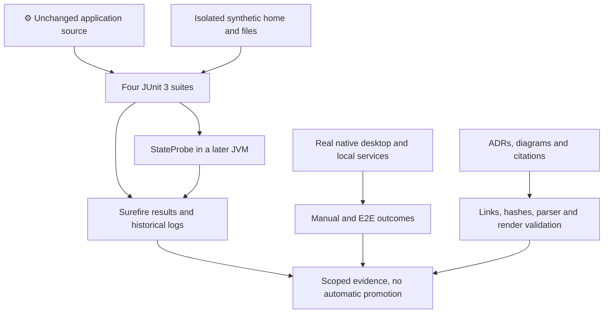
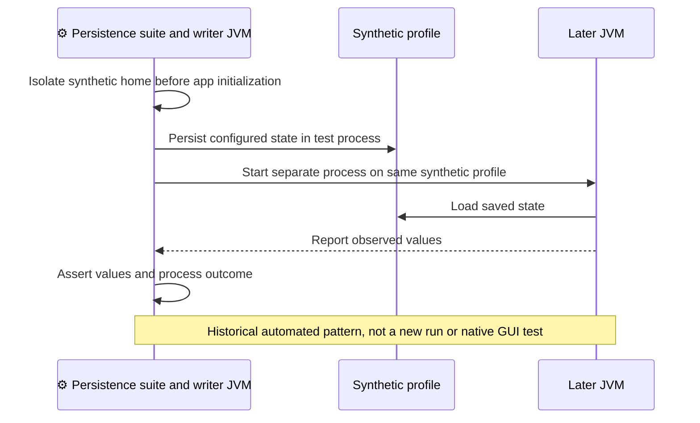

# ADR-007: Verification Baseline

**Date:** 2026-10-16 (documentation date, not the historical decision date).

**Status:** Accepted — retrospective baseline.

**PRD:** [Current functionality](../PRD.md). **Application source baseline:** `b5e7657bac97ae567533d74ae487e5ae713379c8`.

**Relates to:** [000-main-architecture.md](000-main-architecture.md).

Accepted means that this records the existing architecture. It does not approve its suitability for modernization or authorize implementation changes.

---

## 1. Scope

Existing automated characterization, historical build/startup evidence, documentation validation and future verification conditions. It does not add tests, choose a new framework, provision a server or declare runtime gaps resolved. Applies to all PRD flows and GAP-01–07.

## 2. Technology Documentation References

| Library | Context7 ID or official docs | Used for |
| --- | --- | --- |
| JUnit legacy TestCase articles | `/junit-team/junit4` | Supplemental historical TestCase documentation only; project dependency remains 3.8.1. |
| Surefire | `/websites/maven_apache_surefire_maven-surefire-plugin` | Discovery/test-phase contract; existing logs identify actual provider/version. |
| Maven | `/websites/maven_apache` | Separate compile, test, package and verify phases. |

## 3. Component Design

Four suites under src/test/java characterize connection configuration, local filtering, favorites persistence and preferences persistence. BehaviorTestCase, PersistenceTestCase and StateProbe provide synthetic-state isolation and later-process checks. user.home must be set before JFTP class initialization. A headless flag does not remove all Windows shell/native prerequisites.

Historical logs show Surefire 3.2.5 using JUnit3Provider, with 26 executed cases and no failures/errors/skips. Surefire is not explicitly pinned in the inspected POM. The tests use real synthetic local state; no endpoint/database mock is introduced by this baseline.

FTP/FTPS transfers, JKS/trust decisions, file monitoring/Desktop, ZIP flows, JavaHelp and complete native manual interaction do not have a demonstrated flow-level pass in the available evidence. A visible/responsive window is startup evidence only.

The existing repository TDD rules remain applicable: new behavior/bug fixes require an expected behavioral Red before minimal production changes; pure refactors require passing characterization and critical mutation detection. Mock creation/refresh follows the fresh authorized capture policy. Real E2E/manual QA uses zero mocks and local synthetic backing services.

## 4. Data Structures

| Evidence | Required attributes / lifetime |
| --- | --- |
| Test result | Command/environment, discovery count, failures/errors/skips and source state. |
| Synthetic profile | Temporary home and files isolated before application loading. |
| Child-JVM probe | Separate process that reads/writes synthetic stored state. |
| Manual observation | Actual native interaction, expected/observed result, logs and relevant screenshots. |
| Documentation manifest | Source/artifact hashes, reference scope, parser/render counts and limitations. |

Ignored local logs are supporting historical artifacts, not tracked release evidence or secrets to publish.

## 5. Interface Contracts

| Check | Input | Output | Not established by it |
| --- | --- | --- | --- |
| Compile | Sources and compatible toolchain | Main compilation result | Test execution, startup or working flow. |
| Unit/characterization | Meaningful inputs/assertions | Actual discovered test results | Uncovered protocol/GUI behavior. |
| Persistence integration | Synthetic files plus later process | Observed disk reload/state | Native dialog behavior or security certification. |
| E2E | Real app and real authorized local services | Actual persisted/file outcomes | A mock or message-only success is insufficient. |
| Manual native QA | Real windows/dialogs | Interaction and screenshots/logs | Browser/headless checks do not substitute. |
| Document validation | Links, hashes and Mermaid | Structural/source/syntax/render evidence | Runtime correctness or historical design rationale. |

## 6. Technical Decisions

### D007-01 — Functionality-focused characterization on existing JUnit

**Status:** Accepted — retrospective baseline.

**Date:** 2026-10-16, recorded retrospectively.

**Context:** The recorded startup work established tests before minimal build repairs and kept production behavior unchanged.

**Decision:** Record four behavior suites and synthetic cross-process persistence as the executed baseline.

**Rejected alternatives:** The startup record documents characterization-first/minimal-change intent and mutation detection. It does not establish a historical rejection of other frameworks.

**Consequences:**

- (+) Tests detect changes in settings, filtering and stored state without depending on private layouts.
- (-) The 26 cases do not prove full application, transport, certificate or native UI correctness.

**Review trigger:** Revisit when changing covered behavior, fixture isolation, discovery/runner or the test framework.

### D007-02 — Separate automated, startup, native and documentation evidence

**Status:** Accepted — retrospective baseline.

**Date:** 2026-10-16, recorded retrospectively.

**Context:** Existing records explicitly leave complete native/manual QA and protocol flows unverified.

**Decision:** Record each check by its actual scope and keep proposed verification scenarios unexecuted until performed.

**Rejected alternatives:** Historical rationale and rejected alternatives are not documented in the examined evidence.

**Consequences:**

- (+) A future reviewer can distinguish a test count or parsed diagram from a real user-flow pass.
- (-) Runtime completeness can remain blocked despite green unit tests or compilation.

**Review trigger:** Revisit when expanding the support matrix, adding service integrations or claiming a formerly unknown acceptance outcome.

## 7. Diagrams

### Component / evidence flow

[Standalone Mermaid](diagrams/007-01.mmd)

### Sequence — cross-process persistence observation

[Standalone Mermaid](diagrams/007-02.mmd)

## 8. Testing Strategy

This record's strategy is evidence preservation and future change verification, not new application implementation. Each focused ADR lists relevant scenarios. The following gates remain unexecuted wherever the linked historical record provides no proof.

| Scenario | Type | Input | Expected observation | Edge / status |
| --- | --- | --- | --- | --- |
| Existing suite inventory | Historical automated | 5 configuration, 7 filtering, 7 favorites, 7 preferences cases | 26 actual executions | No new execution claimed. |
| Mutation sensitivity | Historical controlled characterization | Port/filter/favorite/preference mutations | Critical assertions fail for behavior, then originals restored | Historical, not a bug-fix Red. |
| New feature or bug fix | Future TDD | Agreed changed behavior/regression | Expected behavioral failure before minimal production change | Compilation/setup failure is not valid Red. |
| Pure refactor | Future characterization | Original public behavior | Green baseline and meaningful mutation detection | Preserve observed behavior separately from desired fixes. |
| Local-service and native flow | Future integration/E2E/manual | Real synthetic services/files, actual UI | Success/cancel/error, state and destination evidence | Zero mocks for E2E/manual, not yet performed. |
| Documentation-only change | Document validation | Actual changed docs and source correspondence | Focused diff, links, diagrams, hashes | No app build/startup required. |

### Technical acceptance criteria

- **TAC-007-01 — Historical automated:** recorded final suite counts total 26, with zero failures/errors/skips.
- **TAC-007-02 — Documentation:** executed results are not expanded to uncovered GUI/protocol/certificate behavior.
- **TAC-007-03 — Future guardrail, unexecuted:** new behavior/regression tests fail for the expected behavior before production changes.
- **TAC-007-04 — Future guardrail, unexecuted:** native/manual runtime evidence includes actual affected flows and persisted/destination results with no mocked E2E backing service.
- **TAC-007-05 — Documentation:** source hashes and diagram checks are reported as documentation evidence only.

Source support: [startup verification](../minimal-startup.md), [PRD evidence E01/E05](../product/current-behavior-evidence.md) and [repository verification rules](../../AGENTS.md).

## Change History

| Date | Change | Interpretation |
| --- | --- | --- |
| 2026-10-16 | Initial retrospective baseline. | Source observations and historical execution remain distinct. |

Future decisions update this file and add a dated history entry identifying changed decision IDs, rationale and affected PRD IDs. Git retains prior text; a new ADR number is not required merely to revise this area. No future architecture or test completion is implied by this baseline.
