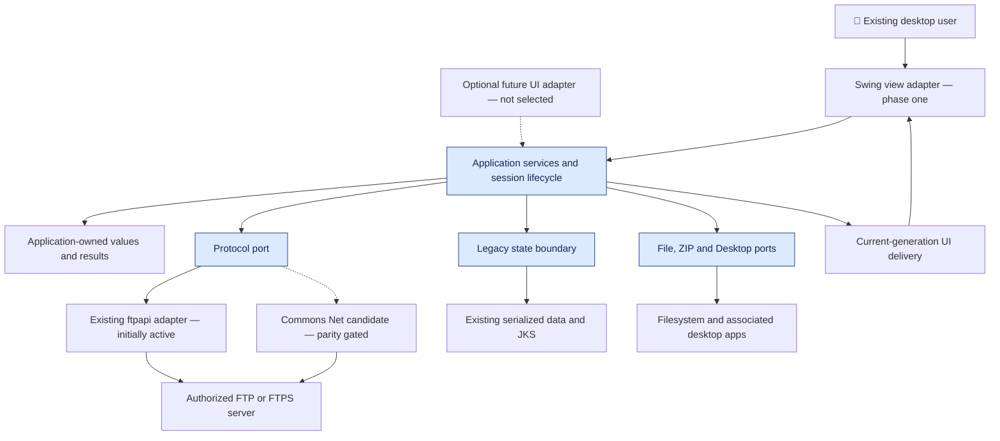
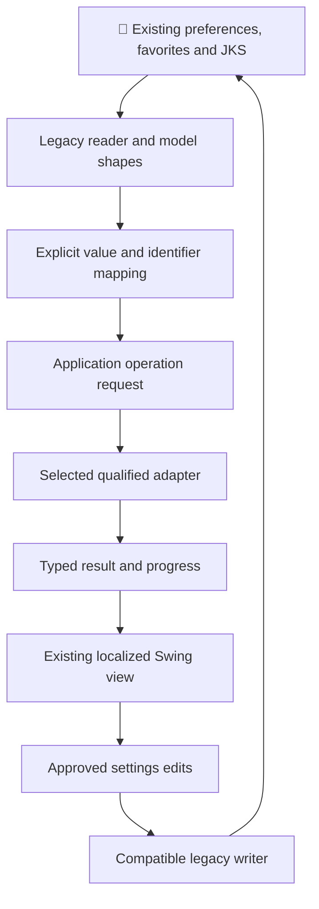
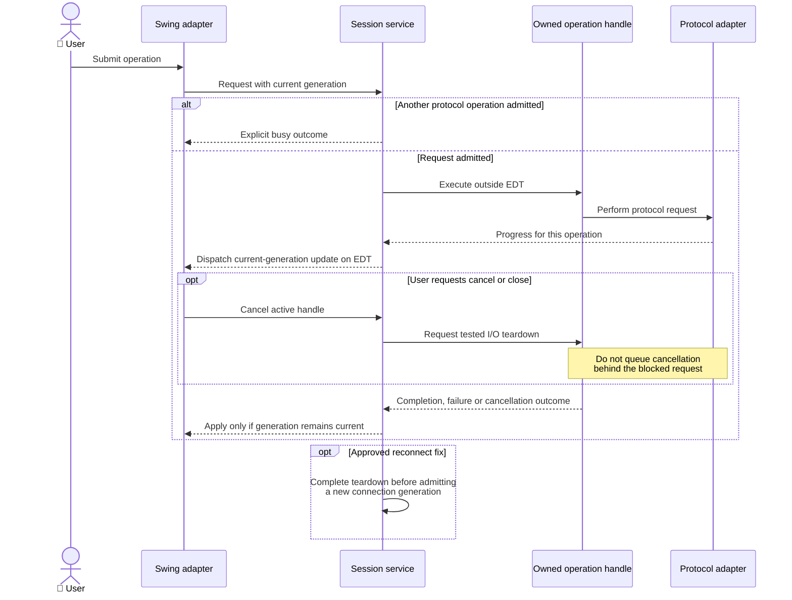
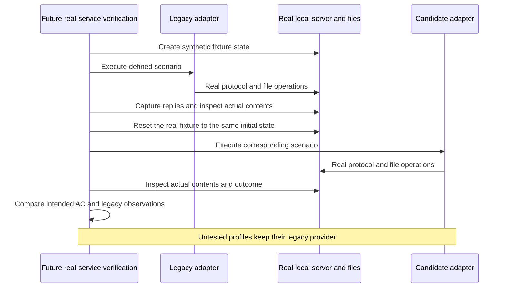
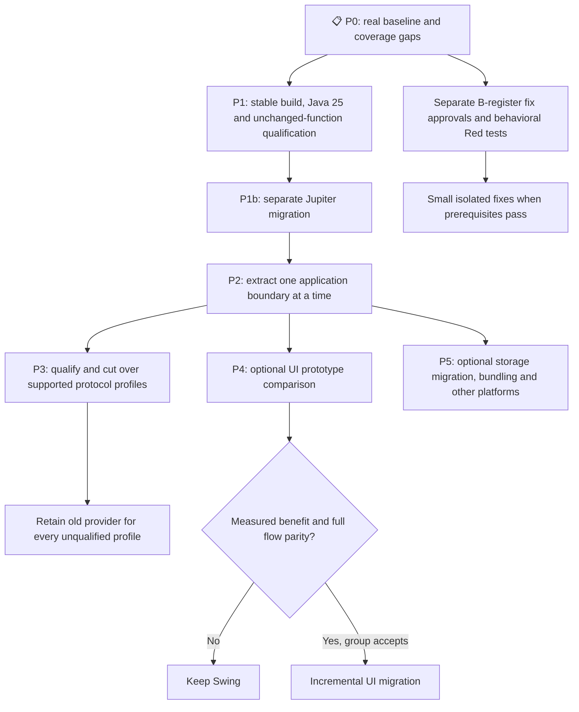
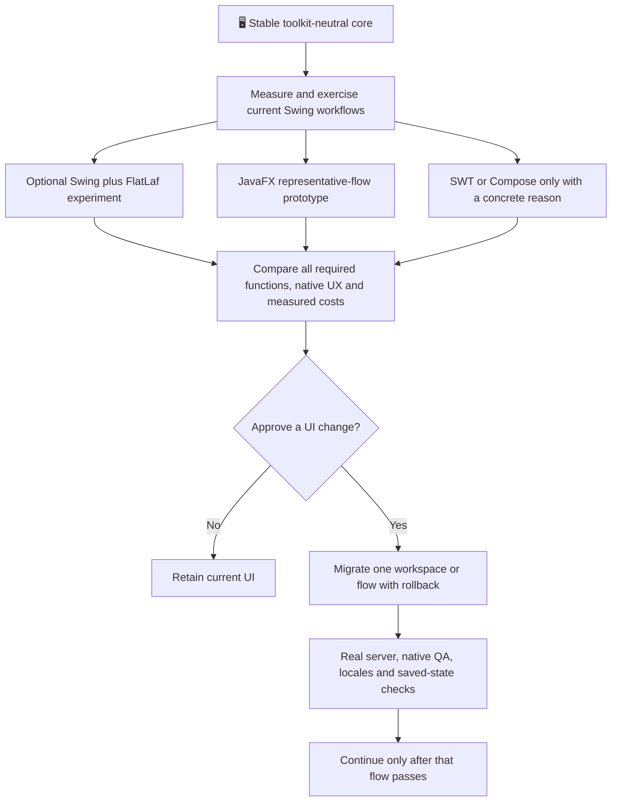

# ADR-008: jFTP Modernization — Architecture Proposal and Roadmap

**Date:** 2026-10-16.

**Status:** Proposed — for group discussion, not implementation authorization.

**PRD:** [Current-functionality baseline](../PRD.md), including its source-audit corrections.

**Relates to:** [Current architecture](000-main-architecture.md) and ADR-001–007. **Examined application revision:** `469ecd58fe268dc759c91905c25ddcabf8782c8d`.

---

## 1. Overview

Modernize the existing desktop application while retaining its user stories, file-transfer capabilities, saved state and localized workflows. The user selected small verified stages, Windows-first qualification, Swing in the first phase, an externally installed Java runtime, and unchanged storage formats initially.

This new coordinating ADR contains recommendations, alternatives and gates. It does not mark existing decisions superseded or describe the proposed architecture as implemented. Once a decision is accepted, update its affected existing area ADR and dated history, as agreed; Git preserves previous descriptions.

The [research report](../research/jftp-modernization-2026-10-16.md) provides source evidence, verified release candidates, the UI shortlist and the behavior-impact register. Source-only findings and documentation checks are not runtime compatibility results.

### Agreed scope versus proposals

| Agreed constraint | Effect |
| --- | --- |
| Preserve all current use cases | No silent removal of FTP/FTPS modes, account login, parser/profile choices, filters, named/ZIP transfers, commands, Desktop actions, favorites, certificate operations or help/update entrypoints. |
| Windows first | macOS/Linux code and portability remain concerns, but support is not claimed until separate native lanes pass. |
| Incremental work | Separate build/JDK changes, test migration, core extraction, library replacement and intentional fixes. |
| Keep Swing initially | Research alternatives and prepare a conditional UI roadmap, without adopting a replacement now. |
| Installed Java required | A bundled runtime/installer is a later option, not a first-stage requirement. |
| Preserve stored data initially | No records conversion of persisted classes, new JSON schema, JKS conversion or credential-vault migration in the initial stages. |
| Fix proposals can change limitations | Every intentional observable change is mapped to PRD criteria and discussed before implementation. |

## 2. Technology Documentation References

Context7 IDs were resolved and queried. For unindexed projects, use official links rather than unrelated matches. Exact-version availability was checked against publisher pages and Maven Central metadata on 2026-10-16; none of the candidates was installed or exercised in this research.

| Technology | Verified Context7 ID or official documentation | Role / qualification |
| --- | --- | --- |
| Java 25 API | `/websites/oracle_en_java_javase_25_api` | Target runtime/language API, Swing, executors and serialization filtering. |
| Java 25 LTS distribution | [Microsoft support roadmap](https://learn.microsoft.com/en-us/java/openjdk/support), [Java LTS roadmap](https://www.oracle.com/java/technologies/java-se-support-roadmap.html) | Recommend Microsoft OpenJDK 25 for continuity with the observed environment; pin a reviewed patched build/checksum when implementing. |
| Maven | `/websites/maven_apache`, [current downloads](https://maven.apache.org/download.cgi) | Recommend stable 3.10.0; Maven 4 RC is not the target. |
| Maven Wrapper | `/websites/maven_apache_tools_wrapper` | Distribution pin/checksum, candidate wrapper plugin 3.3.4. |
| Compiler / test plugins | `/apache/maven-compiler-plugin`, `/websites/maven_apache_surefire_maven-surefire-plugin` | Candidates Compiler 3.16.0, Surefire/Failsafe 3.6.0; current contracts do not prove project compatibility. |
| JUnit | `/junit-team/junit-framework`, [official project](https://junit.org/) | Jupiter 6.1.3 candidate. Current runtime requirement is Java 17+; no automatic JUnit 3 source compatibility is assumed. |
| Apache Commons Net | `/websites/commons_apache_proper_commons-net`, `/apache/commons-net` | Candidate 3.13.0, only behind a parity-qualified adapter. Official Javadoc/source overrides contradictory generated retrieval snippets. |
| Real local test server | [Apache FtpServer](https://mina.apache.org/ftpserver-project/) | Candidate 1.2.1, test-only real server/filesystem, not an endpoint stub. Runtime/feature compatibility still needs qualification. |
| JavaFX | `/websites/openjfx_io`, `/websites/openjfx_io_javadoc_25` | UI evaluation only; an exact future JDK/JavaFX pair is not selected by this ADR. |
| FlatLaf | `/jformdesigner/flatlaf` | Optional Swing appearance experiment after phase one, not an approved visual change. |
| SWT/JFace | [SWT](https://eclipse.dev/eclipse/swt/), [Display contract](https://help.eclipse.org/latest/topic/org.eclipse.platform.doc.isv/reference/api/org/eclipse/swt/widgets/Display.html) | Java/native-widget UI alternative; no matching Context7 project found. |
| Compose Desktop | `/jetbrains/compose-multiplatform`, `/jetbrains/kotlin-multiplatform-dev-docs` | Kotlin/JVM UI alternative and Swing interoperability, evaluation only. |
| Web desktop alternatives | `/tauri-apps/tauri-docs`, `/electron/electron` | Evaluate additional web/process/runtime boundaries, not a selected rewrite. |
| Optional packaging | [JDK 25 jpackage](https://docs.oracle.com/en/java/javase/25/jpackage/packaging-overview.html) | Can package classpath applications; requires per-target builds. Deferred by user preference. |
| Commons VFS | [Official filesystem providers](https://commons.apache.org/proper/commons-vfs/filesystems.html) | Broader filesystem abstraction considered, not selected. No matching Context7 ID. |

The candidate version table in the report is a dated research result, not a floating-version policy or a completed dependency/security assessment. Recheck before implementation.

## 3. System Architecture

### Architecture pattern

Retain one desktop process and initially one Maven artifact. Introduce application-owned contracts between the UI, session orchestration and infrastructure adapters. The proposed core must not depend on Swing, JavaFX, ftpapi or Commons Net types.

The first adapter delegates to the existing protocol implementation. A later Commons Net adapter is a candidate for qualified profiles. Keeping a legacy provider for an unqualified profile is an explicit compatibility choice, not an automatic insecure retry after a TLS failure.

### Repository structure

Existing production, tests and resource roots remain in place initially. Add focused application/model, port and adapter packages inside the same build only as their pilot flow is extracted. Do not rename persisted classes, reflective identifiers or resource keys as a cosmetic cleanup.

A future physical module split or JPMS conversion requires evidence of a useful boundary. Neither is a prerequisite for compiling with Java 25 or evaluating classpath packaging.

### Target stack and initial sequence

| Area | Recommendation | Initial boundary |
| --- | --- | --- |
| Java | Supported patched OpenJDK 25 LTS, final language features only | Prove current behavior first, then raise the language target in a separate step. |
| Build | Maven 3.10.0 via wrapper, reviewed pinned plugins | No Maven 4 prerelease or wholesale publishing configuration rewrite. |
| Tests | Preserve existing characterization, then migrate to Jupiter 6.1.3 | Do not change test assertions and production behavior together. |
| UI | Existing Swing screens/resources | FlatLaf/JavaFX/other UI adoption remains conditional. |
| Orchestration | Application-owned session/task lifecycle | One admitted protocol operation per session, explicit cancellation/close ownership and EDT delivery. |
| Protocol | Legacy adapter first; Commons Net 3.13.0 candidate | All used capabilities must be qualified before retiring the corresponding legacy path. |
| Saved data | Existing Java serialization/JKS adapters | Existing class names, UIDs, field shapes and supported old forms remain intact initially. |
| File/ZIP/Desktop | Application-owned ports over existing Java facilities | Do not add another archive library solely to rename existing ZIP code. |
| Distribution | Corrected runnable distribution using installed Java 25 | Bundled runtime/native installers are optional later work. |

## 4. Module Structure & Dependencies

| Proposed responsibility | Depends on | Must not depend on |
| --- | --- | --- |
| Swing view/adapter | Application commands, immutable view state, existing resources | Direct protocol-library objects once a flow is extracted. |
| Session application service | Application models and ports, explicit task lifecycle | Frame/dialog references or toolkit event-loop APIs. |
| Protocol port | Application-owned profile, entry, operation and result concepts | Either external FTP implementation. |
| Legacy / Commons Net adapters | Their library, type/identifier mapping and platform TLS services | Swing controls. |
| State adapter | Existing serializable classes and stores | A new on-disk schema in the initial stages. |
| File/archive/Desktop adapters | Java filesystem/ZIP/Desktop facilities | Session widgets or protocol-specific metadata types. |
| UI event adapter | Toolkit dispatch and generation-aware results | Blocking network/disk work on the EDT. |

This is a proposed direction, not a claim that current frame/session cycles have disappeared. Pilot one flow before moving the remaining operations. A fully extracted core should have no reverse dependency on a UI or third-party FTP package.

## 5. Data Models

| Concept | Fields / ownership | Compatibility rule |
| --- | --- | --- |
| Connection profile | Host/login/account reference, passive flag, four-valued SSL usage, implicit SSL port, dataChannelUnencrypted flag, timeout/buffer, parser/client profile, paths and post-login command list | Map existing values and flag polarity explicitly; do not silently replace unknown implementation IDs with defaults. |
| Remote entry | Path/name/kind, size/time, permissions/owner/group/link metadata | Preserve values needed by sorting, properties, filtering and recursive operations. |
| Operation request | Operation ID, session generation, selection, destination and options | Snapshot inputs; no new end-user transfer queue is introduced. |
| Operation result | Completed, failed, cancelled or busy plus relevant data/error | Pane refresh is not the success signal. |
| Session view state | Connection state, active operation, generation, listings and progress | Stale/closed-session results must not mutate the active UI. |
| Legacy stored model | Current RemoteHost/Favorite/JFTPPreferences object graphs and JKS data | Do not convert these classes to records or change serialization identifiers in a language cleanup. |

Records and sealed result variants are appropriate candidates for **new nonpersistent** value contracts. They are not a mandate to rewrite every class. Credential-bearing data must not gain an automatic diagnostic representation that prints passwords or keys.

Use generics, try-with-resources and java.time only with characterization of affected semantics. Preserve null/ordering/mutability contracts and date/timezone behavior; immutable collection factories and stricter date parsing can change observable behavior.

## 6. API / Interface Contracts

No network application API or new service deployment is introduced.

| Boundary | Input | Output | Required behavior / gate |
| --- | --- | --- | --- |
| Submit session operation | Current generation and approved request | Typed result and progress events | At most one admitted protocol operation per session; conflicting work has an explicit busy outcome. |
| Cancel/close | Active operation handle | Cancellation/teardown outcome | Never queue cancellation behind the blocking transfer it must interrupt. Backend I/O cancellation needs a tested close/abort strategy; Future cancellation alone is not proof. |
| Reconnect | Approved current/new profile | New generation after completed teardown | Proposed fix for AC-10, separately accepted and tested before changing production. |
| Protocol provider | Explicit mapped profile and application-owned entries | Listing/transfer/command results | Qualify account login, active/passive, four security modes, implicit port/data-channel flags, JVM-wide SOCKS proxy/authentication, ASCII/binary mappings, parsers, filters, metadata/maintenance, commands, temp edit-back and progress/error/abort events. |
| TLS policy | Existing configured stores, chain/host and user decision | Validated connection or explicit warning/rejection | Do not rely on candidate-library defaults for certificate/hostname validation. Preserve explicit Yes/Install distinctions unless a reviewed policy changes them. |
| Legacy storage | Supported existing aggregates | Same compatible stored forms | No hidden migration, plaintext-fallback removal or JKS conversion in initial stages. |
| UI delivery | Current-generation result | Existing localized UI update | Toolkit dispatch boundary owns thread transfer, no core Swing imports. |

Unknown overwrite/resume behavior and rare profile compatibility must be established with actual local-service evidence before a provider cutover. An OS/400 listing parser in another library is not proof of AS/400 client-behavior equivalence.

## 7. Environment Variables

| Variable / setting | Purpose | Required | Example |
| --- | --- | --- | --- |
| JAVA_HOME | Select the reviewed JDK 25 for the proposed build | For the documented build procedure | Installed JDK directory, not a hard-coded developer path. |
| PATH / launcher Java path | Find the installed supported Java runtime | Runtime must be available | Java 25 executable. |
| JVM user.home | Existing profile-root system property | Preserve current semantics | Synthetic isolated path for checks, normal home for real users. |

No new API key, cloud account, database or LLM credential is required. Synthetic verification must set the home before legacy class initialization and disable the historical updater in that synthetic profile; it must not modify personal state.

## 8. Technical Decisions

### D008-01 — Preserve use cases through verified small stages

**Status:** Proposed. **Date:** 2026-10-16.

**Context:** The current baseline contains both source-confirmed paths and unverified or defective outcomes. A simultaneous rewrite would make regressions difficult to attribute.

**Decision:** Separate baseline capture, build/JDK, test migration, core extraction, provider cutover and intentional fixes into reviewable verified steps.

**Rejected alternatives / alternatives not selected for the initial phase:**

- One rewrite of UI, protocol, storage and runtime: attribution and rollback would be substantially harder.
- Treating every recorded limitation as a permanent requirement: the user explicitly requested separate proposals for fixes.

**Consequences:**

- (+) Each step can be compared with an unchanged reference and rolled back independently.
- (-) Coverage and manual/local-service prerequisites must be established before broad replacements.

**Review trigger:** A stage changes more than its declared behavior set or cannot be validated on the agreed platform.

### D008-02 — Java 25 LTS and deliberate language adoption

**Status:** Proposed. **Date:** 2026-10-16.

**Context:** Compilation currently targets Java 8 while only limited historical Windows/JDK-21 execution is recorded. New language constructs can also change stored-model and collection semantics.

**Decision:** Target supported Microsoft OpenJDK 25 LTS for Windows first, without preview features. First qualify the runtime/toolchain, then raise release/language use and modernize one characterized area at a time.

Use typed collections and diamond syntax at nonpersistent boundaries while preserving ordering, null, equality and mutability behavior. Consider records/sealed results and exhaustive switches for new application-owned contracts, not old serialized classes. Apply try-with-resources only where resource ownership and exception/close behavior are characterized. Evaluate java.time at adapter boundaries with explicit time-zone/format compatibility. Replace deprecated reflective/boxing calls in focused changes after checking their exception and identity behavior; avoid a repository-wide syntax rewrite.

**Rejected alternatives / alternatives not selected for the initial phase:**

- Java 21 as final modernization destination: a useful measured baseline, but not the latest verified LTS target for this proposal.
- Following every non-LTS/preview release: additional upgrade cadence without a demonstrated product need.
- Converting persisted classes to records: changes serialization/model contracts.

**Consequences:**

- (+) Uses a currently supported LTS and final Java language facilities.
- (-) Actual dependency, resource, native and packaging compatibility on JDK 25 is unexecuted.

**Review trigger:** A required dependency/platform cannot qualify on 25 or the vendor support/update policy changes.

### D008-03 — Reproducible stable Maven build

**Status:** Proposed. **Date:** 2026-10-16.

**Context:** The checkout has no wrapper and several very old explicit plugins; default runner versions are not a reproducibility contract.

**Decision:** Propose Maven 3.10.0 via a checksum-pinned wrapper, with reviewed stable plugin pins from the report. Preserve all five resource roots and replace the launcher/root-JAR mismatch as a separately tested build fix.

**Rejected alternatives / alternatives not selected for the initial phase:**

- Maven 4 RC or Compiler Plugin 4 beta: prerelease/toolchain changes are unnecessary here.
- Gradle conversion: a separate build-language migration offers no demonstrated benefit for this one-artifact project.

**Consequences:**

- (+) Makes the selected toolchain and discovered test execution reviewable.
- (-) Current dependency resolution and old publishing extensions still need review and execution evidence.

**Review trigger:** A chosen plugin requires a different Maven/JDK version or a build artifact/resource changes.

### D008-04 — Jupiter after preservation of the existing tests

**Status:** Proposed. **Date:** 2026-10-16.

**Context:** Only 26 historical cases cover configuration, filtering and persistence; they do not establish full application parity.

**Decision:** Keep the current assertions and fixture guarantees while separately migrating the small suite to Jupiter 6.1.3. Propose Surefire/Failsafe 3.6.0 and a real local Apache FtpServer 1.2.1 test fixture for supported FTP/FTPS scenarios.

**Rejected alternatives / alternatives not selected for the initial phase:**

- Keeping JUnit 3.8.1 indefinitely: a baseline bridge, not the intended long-term test model.
- Permanent Vintage bridge: current upstream treats it as a temporary migration path.
- Mocked FTP responses as E2E proof: contradicts repository requirements.

**Consequences:**

- (+) Allows modern test lifecycle/parameterization while retaining behavior-focused assertions.
- (-) Runner/fixture migration can accidentally change test discovery or initialize the real user profile too early.

**Review trigger:** The same behavioral scenarios/critical mutations are no longer detected or a provider profile lacks real-service evidence.

### D008-05 — Toolkit-neutral application core before library or UI replacement

**Status:** Proposed. **Date:** 2026-10-16.

**Context:** FTPSession combines widgets, protocol state and operations; 29 files directly import the legacy FTP API.

**Decision:** Introduce application-owned models/ports and extract one flow at a time, retaining one Maven artifact initially. Keep external library and Swing types in adapters and preserve old stored types behind a legacy state boundary.

**Rejected alternatives / alternatives not selected for the initial phase:**

- Package renaming without dependency separation: does not remove coupling and can break persisted/reflected identifiers.
- Microservices, a database or a web backend: no current user story needs these deployment boundaries.
- Immediate JPMS split: not required for the runtime upgrade and complicates legacy reflection.

**Consequences:**

- (+) Provides a reusable core for both the initial Swing UI and a later optional UI.
- (-) Adapter/model mapping must preserve metadata, filtering, errors and credential handling.

**Review trigger:** A core package imports UI/library types or the boundary cannot support an existing story.

### D008-06 — Owned task lifecycle and explicit session serialization

**Status:** Proposed. **Date:** 2026-10-16.

**Context:** The custom worker's completion is conditional on normal return, and session operations/cancellation can overlap.

**Decision:** Propose an application-owned task runner backed initially by standard ExecutorService platform-thread facilities, one admitted protocol operation per session, current-generation UI delivery and a tested independent cancellation/teardown path. All UI callbacks cross the Swing EDT adapter.

**Rejected alternatives / alternatives not selected for the initial phase:**

- Mechanical replacement by javax.swing.SwingWorker alone: useful for GUI work but does not define session ordering, stale-result handling or network cancellation.
- Virtual threads as an automatic fix: not a session/thread-safety/cancellation contract; evaluate later only for a measured concurrency need.
- A user-visible transfer queue: not part of this modernization scope.

**Consequences:**

- (+) Makes ownership, completion, failure and shutdown explicit.
- (-) Reconnect/cleanup corrections are observable changes and must follow the impact register.

**Review trigger:** A result reaches a closed/wrong-generation view, two operations touch one client concurrently, or cancellation cannot stop its owned I/O.

### D008-07 — Commons Net candidate behind a legacy-compatible port

**Status:** Proposed. **Date:** 2026-10-16.

**Context:** The old API is reflected, persisted by implementation name and used for much more than simple upload/download.

**Decision:** Shortlist Commons Net 3.13.0 as the replacement candidate after core extraction and parity qualification. Keep the legacy provider for every profile that is not yet qualified, including special AS/400/parser/proxy cases; do not remove ftpapi merely because the default transfer works.

**Rejected alternatives / alternatives not selected for the initial phase:**

- Direct API substitution across the UI: increases migration scope and loses the isolation needed for comparison.
- Commons VFS as default: useful for a multi-provider filesystem product, but broader abstraction and URI semantics are not currently required.
- Adding SFTP/cloud providers: new functionality outside this task.

**Consequences:**

- (+) Uses an independently maintainable candidate without silently dropping supported configuration.
- (-) Optional TLS, account commands, parsing, progress and cancellation require explicit adaptation; default security settings are not sufficient evidence.

**Review trigger:** Any existing capability/profile fails parity or a required legacy identifier is unmapped.

### D008-08 — Keep existing storage initially, separate future migration

**Status:** Proposed. **Date:** 2026-10-16.

**Context:** Current serialization, inherited Favorite/RemoteHost types, class identifiers, password fields and JKS caches form compatibility contracts.

**Decision:** Keep old read/write forms in initial stages. A later storage proposal may evaluate versioned nonsecret settings plus a protected credential store, with synthetic compatibility fixtures, backup, explicit migration and rollback. Deserialization filtering requires proof for all supported graphs, including sealed favorites, before adoption.

**Rejected alternatives / alternatives not selected for the initial phase:**

- Immediate JSON/record/JKS conversion: conflicts with the chosen first-stage compatibility boundary.
- Assuming embedded-key AES or raw preference serialization provides a secret vault: contradicts source evidence.
- Replacing file state with a database solely for modernization: adds operational cost without an existing requirement.

**Consequences:**

- (+) Limits upgrade risk to saved settings, favorite definitions and externally configured certificate stores.
- (-) Known storage/credential weaknesses remain until a separately agreed change is implemented.

**Review trigger:** Any stored class/field/format, identifier, credential handling or store path/cache policy is changed.

### D008-09 — Keep application functions, propose safety fixes explicitly

**Status:** Proposed. **Date:** 2026-10-16.

**Context:** Source inspection found unsafe ZIP destination resolution and nonstandard server trust checks, alongside recorded lifecycle/failure limitations.

**Decision:** Use the report's B-register for separately reviewed behavior changes. Prefer JDK ZIP/filesystem facilities with verified extraction containment and platform X.509/hostname validation with explicitly defined user-override semantics, rather than retaining unsafe behavior or adding libraries by age alone.

**Rejected alternatives / alternatives not selected for the initial phase:**

- Silently fixing behavior during a refactor: makes PRD acceptance and regressions ambiguous.
- Blindly copying legacy or candidate FTPS defaults: neither establishes a standard validated trust policy.
- Adding new archive formats or automatic synchronization: not needed for existing use cases.

**Consequences:**

- (+) Preserves the product boundary while making safety outcomes reviewable and testable.
- (-) Some existing error/warning/failure paths intentionally change and need accepted criteria.

**Review trigger:** A proposed fix changes an AC/input boundary or cannot preserve a legitimate existing use case.

### D008-10 — External Java distribution first

**Status:** Proposed. **Date:** 2026-10-16.

**Context:** The user chose to keep a separately installed runtime and defer bundled installers.

**Decision:** Ship a verified distribution/launcher for installed supported Java 25 on Windows first. Keep jpackage and a bundled runtime as an optional later decision, with native builds and runtime-module/resource qualification per platform.

**Rejected alternatives / alternatives not selected for the initial phase:**

- Bundled runtime as a mandatory first milestone: not the selected distribution scope.
- Native-image/AOT conversion now: adds a separate qualification problem for reflection, serialization and desktop integrations without a measured requirement.

**Consequences:**

- (+) Preserves the selected installation model and keeps the first release smaller in scope.
- (-) Users still need a supported installed runtime; native packaging and automatic runtime updates are not solved.

**Review trigger:** The group requires zero-Java-install onboarding or approves platform-specific installers.

### D008-11 — Swing first, evidence-based future UI choice

**Status:** Proposed. **Date:** 2026-10-16.

**Context:** A UI rewrite is not needed to change the Java target or decouple application logic, but the user requested a researched alternative roadmap.

**Decision:** Retain Swing and existing screens initially. Evaluate optional FlatLaf for a smaller visual change; shortlist JavaFX first for a full Java-based replacement, with SWT/JFace and Compose Desktop as conditional alternatives. Tauri/Electron need a separate strategic reason. No UI replacement is selected now.

**Rejected alternatives / alternatives not selected for the initial phase:**

- Assuming Swing must be replaced because it is old: it remains in the selected JDK API.
- Declaring JavaFX/Compose faster or more accessible without this application's measurements: unsupported.
- Rewriting the backend and the UI together: hides parity regressions.

**Consequences:**

- (+) The core extraction remains useful whether the UI changes or not.
- (-) A later UI choice needs native prototypes, full function mapping and measured benefits.

**Review trigger:** A prototype demonstrates an agreed product benefit without unapproved lost flows, or a platform/UI requirement cannot be met.

## 9. Diagrams

All views below are **proposed**, not current implementation evidence. Existing flows remain in ADR-001–007; these views show the changed boundaries and qualification process.

### 9.1 Proposed architecture

[Standalone Mermaid](diagrams/008-01.mmd)

### 9.2 Data flow and format compatibility

[Standalone Mermaid](diagrams/008-02.mmd)

### 9.3 Sequence — operation, cancellation and reconnect target

[Standalone Mermaid](diagrams/008-03.mmd)

### 9.4 Sequence — provider qualification, not a performed test

[Standalone Mermaid](diagrams/008-04.mmd)

### 9.5 Stages and approval gates

[Standalone Mermaid](diagrams/008-05.mmd)

### 9.6 Conditional UI migration roadmap

[Standalone Mermaid](diagrams/008-06.mmd)

## 10. Testing Strategy

### Philosophy

This is research/documentation only: no JDK, build, test migration, server or application flow was executed. Preserve historical 26-case evidence without promoting it to modern-runtime proof. Future features/fixes use meaningful behavioral Red before production code; pure refactors start with green characterization and critical mutation detection.

### Layers and evidence requirements

| Layer | Planned scope | Tools / conditions |
| --- | --- | --- |
| Characterization/unit | Existing 26 scenarios, model mapping, filters, admission and typed outcomes | Existing runner first, Jupiter separately; synthetic state and public behavior. |
| Integration | Legacy store formats, child JVMs, parser mapping, real local files and server | Candidate Apache FtpServer 1.2.1 and supported scenarios, no imaginary AS/400 proof. |
| E2E | Real installed-runtime distribution, real local backing services and destination contents | Zero mocks, synthetic credentials/certificates only. |
| Manual native | Actual Swing windows/dialogs, focus, keyboard, drag/drop, cancel/error/restart | Required separately from automated tests; screenshots/logs for changed screens. |
| Documentation | Links, versions/sources, source hashes, diagrams and PRD impact | Does not prove runtime or candidate compatibility. |

Creating/refreshing endpoint or database mocks requires the repository's fresh real-response capture. Parser fixtures must have appropriate source provenance; an invented listing or stub response cannot count as real-service or platform parity.

### Key future scenarios

| Scenario | Input / expected observation | Important boundary |
| --- | --- | --- |
| Existing profile reuse | Synthetic old preferences, favorites and external JKS paths | Same supported fields/formats, no personal state touched. |
| Runtime and packaging | Windows/Java 25, paths with spaces, full resource classpath | Compile, executed tests, launcher startup and native flows are separate results. |
| Protocol parity | Account, active/passive, four security modes, implicit port/data-channel flags, real local SOCKS proxy/authentication, ASCII/binary extension mappings, parsers/filters, metadata/create/rename/delete/SITE CHMOD, commands, named/ZIP transfers, temp edit-back and progress/error/abort events | Verify actual destination contents and expected outcomes; unsupported/rare profiles stay legacy. Proxy remains JVM-wide until a separately qualified change. |
| Session lifecycle | Transfer, failure, cancellation, reconnect and tab close | No stale UI update, no inferred immediate cancellation/rollback. |
| Certificates | Active server manager, client-store configuration, warning Yes/No and View/Install | Install then No is distinct from transient Yes, PKIX/hostname changes require approved outcomes. |
| ZIP safety | Valid archives and approved malicious-path cases | Legitimate extraction retained, no writes outside target after an accepted fix. |
| Optional UI | Same representative workflows and data on each shortlisted toolkit | Measure benefits, do not infer them from framework marketing. |

### Technical acceptance criteria

- **TAC-008-01 — Proposed:** the existing 26 behavioral scenarios remain discovered and meaningful before production modernization, with actual commands/results recorded.
- **TAC-008-02 — Proposed:** the reviewed JDK/build/plugin versions are pinned; no preview Java features or prerelease Maven/plugin target is introduced.
- **TAC-008-03 — Proposed:** extracted application/model packages have no Swing, JavaFX, ftpapi or Commons Net dependency.
- **TAC-008-04 — Proposed fix gate:** one admitted protocol operation per session and generation-aware EDT delivery are demonstrated with real cancellation/close scenarios.
- **TAC-008-05 — Proposed:** supported old saved forms and reflective identifiers survive initial-stage read/write without an implicit format migration.
- **TAC-008-06 — Proposed:** every cut-over profile passes its actual protocol/content matrix; unqualified profiles retain an explicit legacy implementation.
- **TAC-008-07 — Proposed:** each intentional behavior change has an accepted B-register/PRD disposition and an expected behavioral Red before implementation.
- **TAC-008-08 — Proposed:** the packaged launcher starts outside the IDE with installed supported Java and all original localized/help/image resources.
- **TAC-008-09 — Proposed:** no replacement UI is adopted without group approval, measured comparison and complete affected-flow/native verification.
- **TAC-008-10 — Proposed:** after each major verified application step, one assigned publisher creates all three versioned context products and compares them with prior/original snapshots.
- **TAC-008-11 — Proposed:** documentation/source/parser checks are never reported as completed modern-runtime, security or manual acceptance.

### Discussion and next action

The recommendation is to approve only a bounded P0/P1 implementation specification first, after reviewing the B-register and required native/service prerequisites. This ADR does not authorize that implementation. Do not declare a full modernization complete while real-service, storage, packaging or native QA gates remain unperformed.

## Change History

| Date | Entry |
| --- | --- |
| 2026-10-16 | Initial proposed modernization roadmap, based on user constraints, source-only Luna inventories and current official technology research. No implementation or UI replacement accepted. |
