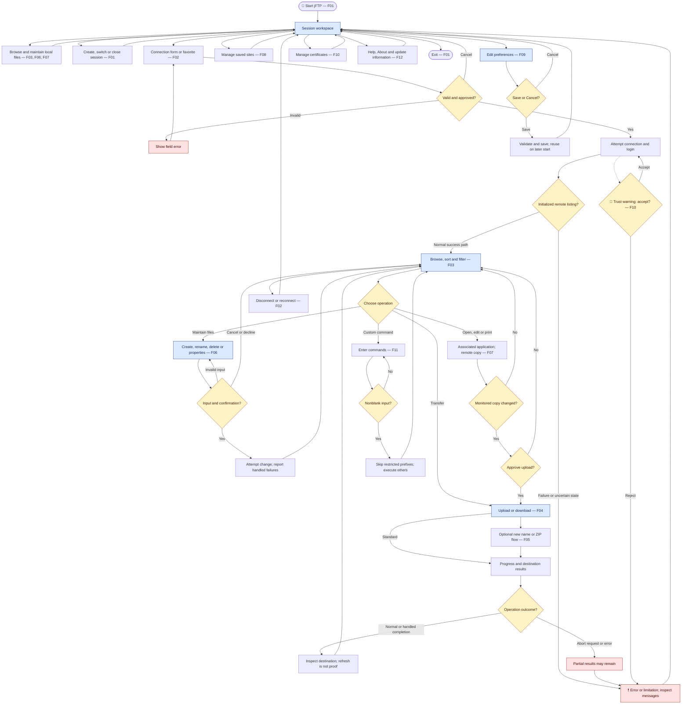

# PRD — jFTP Current Functionality Baseline

**Type:** retrospective product baseline, not a new feature proposal.

**Date:** 2026-10-16. **Baseline version:** 1.1 (source-audit corrections, no application changes).

**Application revision examined:** `dbdc47608d031c287debaa9ba4f7d94665842239`.

**Provenance:** [current-behavior evidence and consistency audit](product/current-behavior-evidence.md).

---

## 1. Executive Summary

jFTP is an existing desktop client for browsing local and remote files and transferring them through FTP or configured FTPS connections. This PRD records its current user-facing capabilities, flows, acceptance criteria and limitations as a reference for future changes. It introduces no new functionality; evidence labels distinguish implemented behavior from outcomes demonstrated by execution.

---

## 2. Problem Statement

Users who maintain files on FTP servers need to navigate two filesystems, transfer selected content, maintain connection details and understand failures. They also need to manage remote files without repeating connection setup for every operation.

Historical feature descriptions and architecture diagrams do not provide a complete product baseline for maintainers. Without stable stories and acceptance criteria, later work can unintentionally alter existing workflows or treat historical compatibility claims as demonstrated behavior.

---

## 3. Users / Personas

These personas are inferred from existing capabilities, not user research.

| Persona | Task | Expected outcome |
| --- | --- | --- |
| File-transfer user | Upload or download files and directory trees between a computer and an FTP site. | Content is available at the chosen destination, with progress and failure information. |
| Remote-content maintainer | Browse, filter, create, rename, delete, edit and inspect remote content. | The site reflects the requested maintenance operation, subject to permissions and server capabilities. |
| Multi-site user | Work in several sessions and reuse saved connection settings. | Switching sites does not require re-entering every parameter; settings can be reused later. |

---

## 4. Main Flows

These are available user paths. A step described here is not automatically an execution-confirmed criterion; see Section 6.

### F01 — Start, use sessions and leave

1. The user starts jFTP; saved preferences or first-use defaults initialize the desktop window.
2. The application creates an initial session with local and remote file areas and status information.
3. The user creates another session or switches tabs; each session maintains its own connection and navigation state.
4. The user closes the selected session or exits. Session close requests connection cleanup; persistence of open tabs for the next launch is not established.

### F02 — Configure, connect, disconnect and reconnect

1. The user opens the connection dialog or selects a favorite.
2. The form exposes server, port and login fields, with optional account, initial directories, post-login commands, advanced connection and security choices.
3. Invalid required fields keep the dialog open with an error. Cancel leaves it unapproved.
4. After approval, the application attempts connection and login and displays status information.
5. On the normal success path, it runs configured post-login commands, applies an initial remote directory if supplied and requests the remote listing.
6. A handled connection/login failure is reported. Later initialization failures have different cleanup behavior and do not guarantee a usable remote listing.
7. The user can disconnect or reconnect. Replacing a connection asks for confirmation; completion of disconnection before the new attempt is not guaranteed.

### F03 — Browse, sort and filter

1. The user chooses a local directory or, when connected, a remote directory.
2. The application requests and displays the corresponding filtered listing.
3. The user enters a directory, moves to its parent or changes the path; handled navigation failures are reported.
4. Column headers control sorting. Separate filters control the local and remote listings.
5. Local filters include name, modification date, hidden-file handling and inclusion/exclusion behavior. Local directories remain navigable.
6. Remote filters include name/date criteria. Filters also affect children visited by recursive transfers, deletion and permission changes.

### F04 — Transfer, inspect progress and request abort

1. In a connected session, the user selects local items to upload or remote items to download. Dragging a selection between the session panes invokes the same standard action for the current destination; dropping does not select a different subdirectory destination.
2. The application processes the selection and recursively visits eligible directory children.
3. Transfer type is selected manually or from extension mappings and a fallback setting.
4. Progress events update transferred amount, elapsed time and average speed.
5. The user can request Abort while connected. This does not guarantee immediate stopping, rollback or removal of partial results.
6. A handled file error can be followed by processing another selected item.
7. The destination listing is refreshed on normal/handled completion paths. A refreshed pane alone does not prove successful delivery.
8. The user inspects destination content and messages. Actual end-to-end contents and existing-destination handling have not been demonstrated in the available evidence.

### F05 — Transfer under another name or use ZIP variants

1. For Upload As or Download As, the user selects an item and approves a destination name; cancellation leaves the action unsubmitted.
2. For Zip and Upload, the user selects local content and supplies archive/destination options, including optional local-archive deletion.
3. The application creates the archive from eligible content and attempts upload.
4. For Download and Unzip, the user selects a remote ZIP item and approves extraction options.
5. The application attempts download and then requests extraction, with optional archive deletion. It does not require confirmation of download success before attempting extraction.
6. Handled errors are reported and affected listings refreshed. Cleanup does not prove that every earlier step succeeded.

### F06 — Maintain files and inspect properties

1. The user chooses a local or remote create, rename, delete or properties action.
2. Creation requests a name. Rename offers editable source and destination text; blank values are rejected.
3. Delete asks for confirmation, then visits eligible selected files/directory children.
4. Local properties display file information. Remote properties also offer permission changes and a recursive option.
5. The application attempts the operation and reports handled failures. Local deletion does not reliably report every failed deletion.
6. Paths can be typed into rename forms, but successful cross-directory moves depend on the filesystem/server and remain unverified.

### F07 — Open, edit and print through desktop applications

1. The user opens, edits or prints a regular file; opening a directory navigates instead.
2. Local-file actions request the corresponding associated desktop application.
3. Remote-file actions first download a temporary copy and open, edit or print that copy.
4. A detected change to a monitored temporary copy prompts for upload.
5. Yes requests upload; declining does not approve it. This is not automatic synchronization or remote-edit conflict resolution.
6. When desktop integration is supported, caught operation failures are reported. An unsupported desktop integration can leave the action without an external application opening. Editor/printer availability is external to jFTP.

### F08 — Maintain and reuse favorites

1. The user opens Favorites and adds or edits a named connection definition.
2. Duplicate favorite names are rejected.
3. The user can confirm deletion or connect using the selected definition.
4. The application attempts to save when the dialog closes and before connecting through a favorite. Save errors are reported, but closing or connection can still proceed.
5. A later load restores saved definitions; damaged favorite data can produce an error.
6. Storage includes an unencrypted fallback, so encryption is not unconditional.

### F09 — Change preferences and reuse them later

1. The user chooses regional, UI, transfer, connection, proxy, security or update settings.
2. Save validates the panels and requests application/persistence of submitted values.
3. Cancel closes without invoking the dialog save operation.
4. A later launch loads saved settings. Locale applies at startup; saving it does not rebuild current screens immediately.
5. Damaged preferences currently fall back to defaults. This is observed behavior, not an approved recovery experience.

### F10 — Manage certificates and answer trust warnings

1. The user opens the certificate manager, whose active tab exposes the server certificate collection. The client-store path remains configurable through Preferences; its manager tab is not active.
2. The user imports a server certificate, views details or confirms deletion.
3. During a configured secure connection, failed date, host or trust checks can open a security warning.
4. The user can inspect the certificate and accept or reject the warning. This certificate view also offers Install, which requests saving the chain to the server certificate collection.
5. Yes accepts the chain for the trust-manager instance without itself importing it. Install is a separate persistent action and is not undone by a later No in the warning. No fails the connection's trust check.

### F11 — Run custom commands and inspect messages

1. In a connected session, the user opens the command dialog and enters nonblank command lines.
2. Blank input is rejected; accepted lines are processed in order.
3. Certain prefixes are silently skipped rather than executed; see AC-63.
4. Other commands are submitted, with handled errors and session messages exposed in the log.

### F12 — Consult help and update information

1. The user opens Contents, Tips, FAQ, Support, Feedback or About through available desktop entrypoints.
2. The application requests the corresponding content or information window.
3. Update preferences expose automatic checking and Check Now.
4. Automatic checking starts only when enabled. Historical update-service availability and update delivery are unverified.

---

## 5. User Stories

Identifiers are permanent references, not priority rankings. An available path does not imply runtime acceptance of its outcome.

| ID | Story | Flow | Criteria |
| --- | --- | --- | --- |
| US-01 | As a multi-site user, I want separate session tabs, so that I can switch between sites and current locations. | F01 | AC-01–04 |
| US-02 | As a file-transfer user, I want connection and login settings, so that I can access a chosen site. | F02 | AC-05–08, AC-83, AC-87 |
| US-03 | As a file-transfer user, I want invalid input and login failures reported, so that I can correct my attempt. | F02 | AC-05–09 |
| US-04 | As a multi-site user, I want disconnect and reconnect actions, so that I can end or repeat a connection. | F02 | AC-10, AC-84–85 |
| US-05 | As a content maintainer, I want to browse and sort both locations, so that I can find content. | F03 | AC-11–13 |
| US-06 | As a content maintainer, I want separate filters, so that I can select files to display or process. | F03 | AC-14–17, AC-74–75 |
| US-07 | As a file-transfer user, I want selected files and directory trees transferred, so that content reaches another location. | F04 | AC-18–20, AC-25–26, AC-77 |
| US-08 | As a file-transfer user, I want progress and an abort request, so that I can monitor and interrupt work. | F04 | AC-21–24, AC-67–68 |
| US-09 | As a file-transfer user, I want transfer-type controls, so that content uses my selected mode. | F04 | AC-27–29 |
| US-10 | As a content maintainer, I want a different destination name, so that I can transfer an item under that name. | F05 | AC-30, AC-69 |
| US-11 | As a file-transfer user, I want ZIP upload and download/extraction, so that I can transfer grouped content. | F05 | AC-31–33 |
| US-12 | As a content maintainer, I want creation and rename actions, so that I can organize entries. | F06 | AC-34–36, AC-70–71, AC-76 |
| US-13 | As a content maintainer, I want confirmed deletion, so that I can remove unwanted entries. | F06 | AC-37–39 |
| US-14 | As a content maintainer, I want properties and remote permission controls, so that I can inspect entries and request access changes. | F06 | AC-40–42 |
| US-15 | As a content maintainer, I want desktop applications to open, edit or print files, so that I can work on their content. | F07 | AC-43–44, AC-78–81 |
| US-16 | As a remote-content maintainer, I want to approve upload of edited temporary copies, so that I control sending changes back. | F07 | AC-45–46 |
| US-17 | As a multi-site user, I want persistent named favorites, so that I can reuse site settings. | F08 | AC-47–52, AC-72, AC-86–87 |
| US-18 | As a multi-site user, I want persistent preferences, so that I can reuse my choices. | F09 | AC-53–57 |
| US-19 | As a secure-connection user, I want certificate management and a trust decision, so that I can inspect a certificate involved in a warning. | F10 | AC-58–61, AC-73, AC-89 |
| US-20 | As a content maintainer, I want custom commands and session messages, so that I can perform supported site-specific tasks and inspect failures. | F11 | AC-62–64 |
| US-21 | As a desktop user, I want help and application/update information, so that I can understand functions and inspect notices. | F12 | AC-65–66, AC-82, AC-88 |

---

## 6. Acceptance Criteria

These are retrospective criteria, not a declaration that every flow passed runtime acceptance. **Unknown** is not counted as already met. **Source** confirms implementation, not successful execution against a server. Evidence IDs resolve to the companion document; that document records provenance, not an implementation plan.

| Status | Meaning |
| --- | --- |
| Executed | Historical evidence supports this specific behavior. Automated checks and limited desktop observation are identified separately; neither implies full manual QA. |
| Source | A reachable implementation supports the statement; no matching runtime demonstration is claimed. |
| Limitation | Current behavior weakens the outcome or prevents a stronger guarantee. Recording it does not endorse it. |
| Unknown | The outcome is unverified and is not counted as an already-met criterion. |

### Sessions and connection

| ID | Single observable criterion | Status | Evidence |
| --- | --- | --- | --- |
| AC-01 | Starting jFTP displays the main desktop window. | Executed — limited historical startup | E01 |
| AC-02 | New Session adds and selects another session tab. | Source | E02 |
| AC-03 | Switching tabs selects that session's panes and connection state. | Source | E02 |
| AC-04 | Close Session removes the selected tab. | Source | E02 |
| AC-05 | A blank host, user or password keeps the connection form open with a validation error. | Source | E03 |
| AC-06 | A connection port outside 0–65535 is rejected by the form. | Source | E03 |
| AC-07 | Cancel closes an unapproved connection form without returning a connection definition to its caller. | Source | E03 |
| AC-08 | The form offers plain FTP and optional, explicit and implicit secure-connection modes. | Source — settings only | E03 |
| AC-09 | A handled connection/login failure is reported to the user. | Source | E03 |
| AC-10 | Confirming connection replacement starts a new attempt without waiting for the requested disconnection to finish. | Limitation | E03 |
| AC-83 | After successful login and initialization, the remote pane displays the server's working-directory listing. | Source | E03 |
| AC-84 | Disconnect requests closure of the selected session's server connection. | Source | E03 |
| AC-85 | Reconnect submits the session's existing site definition for a new connection attempt. | Source | E03 |

### Browsing and filtering

| ID | Single observable criterion | Status | Evidence |
| --- | --- | --- | --- |
| AC-11 | Choosing a readable local directory requests its filtered listing for the local pane. | Source | E04 |
| AC-12 | Choosing a remote directory in a connected session requests its remote listing. | Source | E04 |
| AC-13 | Repeated clicks on a sortable column header toggle sort direction. | Source | E04 |
| AC-14 | Local and remote filters are maintained separately per session. | Source | E04 |
| AC-15 | A local name-inclusion filter accepts matching synthetic filenames. | Executed — historical automated | E05 |
| AC-16 | Local directories remain navigable with a local file filter applied. | Executed — historical automated | E05 |
| AC-17 | Local exclusion mode reverses the file-match result, including the hidden-file decision. | Executed — historical automated; legacy behavior | E05 |
| AC-74 | Local date filtering applies the configured modification-date boundaries to synthetic files. | Executed — historical automated | E05 |
| AC-75 | Local inclusion filtering applies the hidden-file setting to synthetic files. | Executed — historical automated | E05 |

### Transfers and modes

| ID | Single observable criterion | Status | Evidence |
| --- | --- | --- | --- |
| AC-18 | Download in a connected session submits selected remote items to the current local destination. | Source | E06 |
| AC-19 | Upload in a connected session submits selected local items to the current remote destination. | Source | E06 |
| AC-20 | Recursive transfer visits children accepted by the relevant side's filter. | Source | E06 |
| AC-21 | Transfer progress events update the displayed transferred amount. | Source | E07 |
| AC-22 | Abort is available while the selected session is connected. | Source | E07 |
| AC-23 | Abort offers no action to roll back content already written. | Limitation | E07 |
| AC-24 | A handled file-transfer error can be followed by processing another selected item. | Limitation | E06 |
| AC-25 | Normal or handled completion of a standard transfer requests a destination-listing refresh. | Source | E06 |
| AC-26 | A completed binary transfer to a previously absent destination produces the source file's contents there. | Unknown — end-to-end outcome not demonstrated | E06 |
| AC-27 | Auto Detect uses the configured type for a recognized extension. | Source | E08 |
| AC-28 | Auto Detect uses the configured fallback for an unrecognized extension. | Source | E08 |
| AC-29 | Manual ASCII or Binary selection determines session transfer type when Auto Detect is off. | Source | E08 |
| AC-67 | The transfer status displays elapsed time while progress is tracked. | Source | E07 |
| AC-68 | The displayed transfer speed is the average over elapsed transfer time. | Source | E07 |
| AC-77 | Dragging a selection between session panes invokes the corresponding standard upload or download action. | Source | E18 |

### Named transfers and archives

| ID | Single observable criterion | Status | Evidence |
| --- | --- | --- | --- |
| AC-30 | Upload As submits the approved remote destination name for the selected local item. | Source | E09 |
| AC-31 | Zip and Upload creates an archive from eligible local selections before attempting upload. | Source | E09 |
| AC-32 | Download and Unzip requires the selected remote item's extension to be ZIP. | Source | E09 |
| AC-33 | Download and Unzip attempts extraction without checking that the preceding download succeeded. | Limitation | E09 |
| AC-69 | Download As submits the approved local destination name for the selected remote item. | Source | E09 |

### File maintenance and properties

| ID | Single observable criterion | Status | Evidence |
| --- | --- | --- | --- |
| AC-34 | New Local File requests the named file in the local location. | Source | E10 |
| AC-35 | New Remote File requests the named file on the connected site. | Source | E10 |
| AC-36 | Rename rejects a blank source or destination. | Source | E10 |
| AC-37 | Rejecting delete confirmation leaves deletion unsubmitted. | Source | E10 |
| AC-38 | Recursive deletion visits only children returned by the active filtered listing. | Limitation | E10 |
| AC-39 | Local deletion can finish traversal without reporting a failed individual deletion. | Limitation | E10 |
| AC-40 | Opening local properties displays entry metadata. | Source | E11 |
| AC-41 | Approving changed remote permission checkboxes requests the corresponding server-side change. | Source — server support dependent | E11 |
| AC-42 | Recursive remote permission changes include eligible directory descendants. | Source | E11 |
| AC-70 | New Local Directory requests the named directory in the local location. | Source | E10 |
| AC-71 | New Remote Directory requests the named directory on the connected site. | Source | E10 |
| AC-76 | Approving nonblank rename input submits its source and destination text for the selected side's rename operation. | Source — move outcome unverified | E10 |

### Associated applications and remote editing

| ID | Single observable criterion | Status | Evidence |
| --- | --- | --- | --- |
| AC-43 | With desktop integration supported, opening a local regular file requests its associated open operation. | Source | E12 |
| AC-44 | With desktop integration supported, opening a remote regular file requests its open operation on a downloaded temporary copy. | Source | E12 |
| AC-45 | A detected change to a monitored remote temporary copy presents an upload decision. | Source | E12 |
| AC-46 | Declining the temporary-copy upload decision does not approve that upload. | Source | E12 |
| AC-78 | With desktop integration supported, editing a local regular file requests its associated edit operation. | Source | E12 |
| AC-79 | With desktop integration supported, printing a local regular file requests its associated print operation. | Source | E12 |
| AC-80 | With desktop integration supported, editing a remote regular file requests its edit operation on a downloaded temporary copy. | Source | E12 |
| AC-81 | With desktop integration supported, printing a remote regular file requests its print operation on a downloaded temporary copy. | Source | E12 |

### Favorites and preferences

| ID | Single observable criterion | Status | Evidence |
| --- | --- | --- | --- |
| AC-47 | A favorite with a duplicate name is rejected. | Source | E13 |
| AC-48 | Approving a favorite edit updates the selected definition in the displayed list. | Source | E13 |
| AC-49 | A saved favorite list restores its connection values in a later process. | Executed — historical automated | E05, E13 |
| AC-50 | Loading an older supported favorite list preserves definitions while rewriting the stored form. | Executed — historical automated | E05, E13 |
| AC-51 | Damaged favorite data produces an I/O failure rather than guaranteed recovery. | Executed — historical automated; limitation | E05 |
| AC-52 | Favorite saving can use an unencrypted fallback when encryption is unavailable. | Limitation | E13 |
| AC-53 | Preferences Save validates panels before applying their submitted values. | Source | E14 |
| AC-54 | Preferences Cancel bypasses the dialog save operation. | Source | E14 |
| AC-55 | Supported saved preference values can be restored by a later process. | Executed — historical automated | E05 |
| AC-56 | The saved locale is applied during application startup. | Source | E14 |
| AC-57 | Damaged preferences load as default settings. | Executed — historical automated; limitation | E05 |
| AC-72 | Confirming deletion removes the selected favorite from the displayed list. | Source | E13 |
| AC-86 | Adding an approved uniquely named favorite inserts its definition into the displayed list. | Source | E13 |
| AC-87 | Connect in Favorites submits the selected saved definition for a session connection attempt. | Source | E13 |

### Certificates, commands and information

| ID | Single observable criterion | Status | Evidence |
| --- | --- | --- | --- |
| AC-58 | The active certificate manager offers import into the server certificate collection. | Source — corrected UI reachability | E15 |
| AC-59 | Selecting a certificate permits viewing its details. | Source | E15 |
| AC-60 | Rejecting a displayed trust warning fails that trust check. | Source | E15 |
| AC-61 | Choosing Yes in a trust warning approves its certificate chain without itself performing permanent certificate import. | Source — transient Yes decision | E15 |
| AC-62 | Blank custom-command input keeps the dialog open with an error. | Source | E16 |
| AC-63 | A command line whose uppercase form in the current locale begins immediately with LIST, NLST, RETR, STOR, STOU, APPE, PASV, PORT, DATA, CWD or CDUP is silently skipped. | Limitation | E16 |
| AC-64 | The message area exposes normal, command, reply, error, status and information message categories. | Source | E07 |
| AC-65 | Selecting a help topic requests its corresponding content. | Source — content launch unverified | E17 |
| AC-66 | Automatic update checking starts on window opening only when enabled in saved preferences. | Source — service availability unverified | E17 |
| AC-73 | Confirming certificate deletion requests removal of the selected certificate. | Source | E15 |
| AC-82 | The platform-appropriate About entrypoint requests application information. | Source — window interaction unverified | E17 |
| AC-88 | Check Now in update preferences requests an update check. | Source — service availability unverified | E17 |
| AC-89 | Install in the certificate view opened from a trust warning requests adding the displayed chain to the server certificate collection. | Source — existing explicit install path | E15 |

### Unresolved acceptance boundaries

These questions do not create new requirements or count as passed criteria.

| ID | Stories | Unknown outcome |
| --- | --- | --- |
| GAP-01 | US-07, US-10 | Existing-destination overwrite, truncation, resume or skip behavior is unverified. No conflict-choice guarantee is recorded. |
| GAP-02 | US-07–11 | Destination contents, interruption effects and ZIP extraction results lack end-to-end evidence. AC-26 remains Unknown. |
| GAP-03 | US-02, US-19 | FTPS negotiation, certificate interoperability and currently usable security versions are unverified. |
| GAP-04 | US-04 | Reconnect timing and initialization failures can leave uncertain session state; no reliable recovery guarantee is recorded. |
| GAP-05 | US-12 | Rename accepts path text, but cross-directory move success is unverified. |
| GAP-06 | US-15–16 | Installed editor/printer behavior, monitor detection and concurrent remote edits are unverified. |
| GAP-07 | US-01, US-17–21 | Complete native interaction, packaged restart, help launches and the historical update service remain unverified. |

---

## 7. Out of Scope

- **Product changes:** no features, fixes, replacement flows or improved recovery behavior are introduced here.
- **Technical design:** architecture, dependency choices, implementation decisions and verification strategy belong in separate technical records or a later ADR.
- **New channels and integrations:** no web/mobile client, organization accounts, administrator portal, cloud-storage integration, AI assistant or additional protocol is specified. Existing FTP login and desktop integration remain in scope for description.
- **New localization:** existing language controls are described; no translations or immediate language-switching feature are added.
- **Stronger transfer guarantees:** no transactional transfer, rollback, conflict resolution, synchronization or queue-management guarantee is introduced.
- **Certification:** historical platform, server and security claims are not verified support commitments.
- **New runtime investigation:** this task does not start the application, contact FTP/update services, use personal state or create new GUI screenshots.

---

## 8. Constraints

### Business

- This document is a reference for agreeing future changes, not authorization to implement them.
- Personas describe available workflows rather than validated market segments.
- No additional organization-specific or legal requirements were supplied; none are inferred.

### Functional

- The product requires a desktop and local filesystem; remote operations require a configured FTP server.
- Remote actions depend on login permissions and server capabilities. Configurable FTPS does not prove interoperability or current security suitability.
- The connection form accepts ports 0–65535; implicit secure-port validation applies when that mode is selected. Form acceptance does not imply reachability.
- No measured maximum file size, item count, throughput, session count or completion-time guarantee is established.
- Filters affect recursive actions, which can omit filtered/hidden children.
- Open/edit/print requires associated desktop applications and operating-system support.
- Certificate import accepts X.509 certificates; private-key import and automatic issuance are not established.
- Historical inventory includes English, Traditional Chinese and German resources; translation completeness and equivalent runtime behavior are unverified.
- Preferences, favorites and certificate collections are separate user state. Current compatibility behavior is part of this baseline; favorites have no unconditional encrypted-storage guarantee.
- Historical operating-system claims do not establish current support. Available desktop observation concerns Windows only and is incomplete.

### Document and data references

| Reference | Location | Use |
| --- | --- | --- |
| Evidence and consistency audit | [Companion evidence](product/current-behavior-evidence.md) | Interpret status, source scope and documentation differences. |
| Architecture views | [Existing architecture](design/jftp-architecture-2026-10-15.md) | Understand responsibilities without treating diagrams as acceptance. |
| Historical execution record | [Startup verification](minimal-startup.md) | Interpret Executed statuses and incomplete manual QA. |
| Historical feature inventory | [README](../README.md) | Locate product claims subject to these evidence limits. |

---

## 9. UI Description (wireframe level)

### Main window and sessions

Menus and a toolbar sit above session tabs. Within a session, the local pane is left and remote pane right, with a message area above and status/progress below. Switching tabs changes active session controls.

Each pane contains a location control, navigation controls and sortable entries. Selection feeds transfer, rename, delete, properties and desktop actions; dragging between panes also invokes standard transfer. Before connection, no remote listing is established; this differs from a connected empty directory. Local listing is asynchronous, so an initially empty-looking pane is not proof of an empty directory.

Connection and transfer work exposes status/progress. Busy-state clearing does not guarantee that follow-up listing finished. Handled failures appear through dialogs or messages. The bounded message area can clear older content and is not a permanent audit history.

### Connection and favorite-property forms

Basic server/login fields are separated from directory, command, advanced and security choices. Connect validates and approves; Cancel closes unapproved. Validation keeps the relevant form available for correction. Favorite properties also request a saved-definition name.

### Favorites

A saved-site list offers Add, Edit, Delete, Connect and Close. Editing/connecting uses the selected definition. An empty list requires creating a definition first; duplicate names are rejected. Deletion requests confirmation. Save errors are shown, but closing or connecting can still proceed. Saving a favorite is distinct from completing its connection.

### Transfer variants and filters

Upload As and Download As request a destination name. ZIP variants expose archive/extraction destinations and optional archive deletion. Filter forms configure the relevant side's criteria; local filtering includes hidden-file behavior. Cancel leaves the corresponding action unapproved. Progress and handled errors return to the workspace.

### File maintenance and properties

Create forms request a name. Rename provides source/destination text without a dedicated move destination chooser. Delete requests confirmation. Local properties show identity, path, type, size, date and directory information. Remote properties add remote metadata and permission checkboxes, with a recursive option.

### Preferences

A category navigator selects Regional Settings, UI, Transfer Modes, General Connection, Advanced Connection, Proxy, Security or Software Updates. Controls cover locale/date-time, appearance, extension mappings, connection defaults, proxy fields, certificate-store settings and update preferences. Save validates/applies; Cancel bypasses saving. Locale takes effect at startup.

### Certificates and security warnings

The active certificate manager displays the server collection and offers import, details and confirmed deletion. Client-store configuration exists in Preferences, but its manager tab is inactive. Trust warnings describe a failed date/host/trust check and offer inspection and Yes/No. Their certificate-details view additionally offers Install. Yes alone is transient; Install requests a persistent server-store change independently of the later warning decision.

### Commands, help and desktop handoff

The command dialog accepts multiline text and rejects blank input. The UI does not reliably explain silently skipped prefixes. Results/errors appear in session messages. Help requests a topic or About information. File actions hand control to an associated application; a detected edit of a remote temporary copy opens a separate upload decision.

---

## 10. User Flow Diagram

This is functional navigation, not a runtime-success certificate. Section 6 determines acceptance status.

---

## 12. Further Notes

### History and future changes

- This replaces the startup-exercise PRD in the same tracked file, as requested. The narrower scope remains in [its Git revision](https://github.com/LucasMatuszewski/jftp-gr2/blob/dd05dd443efd3151e0d0085eca7e356566ad0bda/docs/PRD.md).
- Future change PRDs should reference affected US, AC and GAP IDs and state before/after behavior. No future feature or technical ADR is created here.
- When revising this file, retain IDs and append new ones instead of renumbering. Mark removed/superseded criteria with the reason and relevant commit. Git history retains earlier text without a duplicate baseline file.
- Evidence status is separate from proposed requirements. A later decision can replace a limitation without claiming it was the original accepted behavior.
- Template Section 11 is omitted because this application baseline contains no AI-agent feature.

### Deferred decisions

Gaps and limitations identify decisions for later work. They do not prescribe fixes, a security policy, recovery flows or technical solutions, or decide whether a legacy behavior should be preserved.

### Baseline correction history

| Date | Version | Correction |
| --- | --- | --- |
| 2026-10-16 | 1.1 | Deeper caller/wiring review established that the certificate manager's client tab is commented out and the warning certificate view has a separate Install action. AC-58/61 and F10/UI were clarified, and AC-89 records an existing omitted path. This is a documentation correction, not an implemented feature or newly executed acceptance test. |

## 13. Agreed Sygnity appearance refresh (2026-10-16)

The user authorized a small desktop styling refresh using the supplied Sygnity assets and palette. This change affects presentation in F01/F03/F09 only; the functional baseline and existing acceptance criteria remain applicable.

- AC-90: Display the supplied cyan Sygnity wordmark at the right of the top toolbar, preserving its proportions on a white surface. Branding is decorative and creates no new action or keyboard stop.
- AC-91: Retain every existing toolbar button, icon, tooltip, listener, action order, enabled-state rule, menu, dialog and workflow. Do not change FTP/FTPS, saved settings, favorites, certificates or localization.
- AC-92: Use white and light-gray surfaces, graphite text, restrained cyan/blue accents, flatter borders and modest spacing. Preserve readable selection/focus and the user's chosen look and feel; do not add a UI dependency or download fonts at runtime.
- AC-93: Capture comparable real desktop screenshots before and after, plus selection/dialog and narrower-window states. Review overlap, logo clarity, contrast and keyboard navigation using isolated synthetic state with automatic updates disabled and no external FTP connections. Record build, tests, startup and native QA separately.

These are newly agreed requirements, not claims about historical behavior or completed verification. Detailed results belong in `docs/sygnity-ui-refresh.md`.
