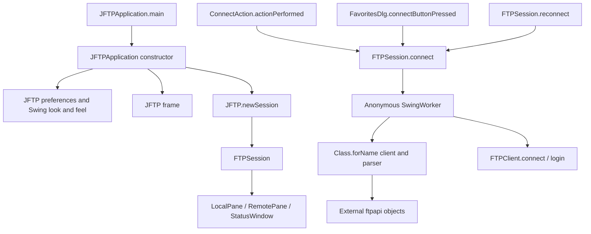

# JFTP connection and startup sketch

Observed from original source at `cdc95025ac74098f129bfd9cdcd613fa6348c8d0`, not inferred solely from graph topology. Citation IDs below refer to [evidence.json](evidence.json). This is a small architecture view for navigation, not a complete class or runtime call graph.

Startup construction, look-and-feel selection, showing the frame and creating a session are directly visible in [JFTPApplication.java](../../src/main/java/com/myjavaworld/jftp/JFTPApplication.java#L32), citation `startup`. The AST graph omits several of these calls; the diagram deliberately follows source. Session creation is at [JFTP.java L148](../../src/main/java/com/myjavaworld/jftp/JFTP.java#L148), citation `new-session`; pane/status-window construction is at [FTPSession.java L287](../../src/main/java/com/myjavaworld/jftp/FTPSession.java#L287), citation `panes`.

The three inspected callers are citations `connect-action`, `connect-favorite` and `reconnect`. The worker constructs the configured FTP client and parser reflectively, configures listeners and SSL as needed, then connects and logs in: [FTPSession.java L617](../../src/main/java/com/myjavaworld/jftp/FTPSession.java#L617), citation `worker`. The worker's remaining body, completion callback and shared state must be read before threading or error-handling changes; this diagram does not establish that those behaviors are correct.

`RemoteHost` stores default implementation names as strings (`ftp-default`), and `pom.xml` declares external `ftpapi:3.0.0` (`dependency`). The library's internals are outside the extracted Java source. Nodes named after imported dependencies are placeholders, not evidence that dependency implementation was analyzed.

## Boundaries needed for the startup exercise

The sketch above is sufficient to locate startup and connection code. It does
not describe persistence or establish a working runtime. The following facts
were checked directly against the original source for the 2026-10-15 exercise:

- `JFTP` initializes preferences before creating a frame. `USER_HOME` reads the
  JVM's `user.home`; `DATA_HOME` is `.jftp/data` underneath it
  ([JFTP.java](../../src/main/java/com/myjavaworld/jftp/JFTP.java#L66)). Isolate
  `user.home` **before class initialization**; changing it later cannot relocate
  these static paths. Preference construction also calls native Swing
  `FileSystemView.getDefaultDirectory`, so a headless JVM on Windows can still
  require functioning Windows shell services
  ([JFTPPreferences.java](../../src/main/java/com/myjavaworld/jftp/JFTPPreferences.java#L81)).
- Preferences use Java serialization in `preferences.ser`
  ([save/load](../../src/main/java/com/myjavaworld/jftp/JFTP.java#L512)). Loading
  damaged data currently returns defaults from a `finally` block, suppressing
  errors. This is observed legacy behavior, not an approved recovery design.
- Favorites use `FavoritesManager` and `favorites.ser`, preserving `RemoteHost`
  data. The reader accepts both an older serialized list and an AES-sealed list;
  reading the older form rewrites it. Damaged streams propagate an I/O failure
  ([FavoritesManager.java](../../src/main/java/com/myjavaworld/jftp/FavoritesManager.java#L70)).
- Local listing wraps real files in `LocalFile`. `LocalFileFilter` combines name,
  date and hidden-file criteria; directories remain navigable. Exclusion mode
  inverts file matches, including the hidden-file decision
  ([LocalFileFilter.java](../../src/main/java/com/myjavaworld/jftp/LocalFileFilter.java#L131)).
  Regex/date implementations belong to the external `ftpapi` JAR and were checked
  against its 3.0.0 sources and actual dialog call sites.
- Maven copies five resource roots, including localized properties, images and
  JavaHelp. Tests/startup must use that combined classpath. The active Mac adapter
  uses reflection; `OSXAdapterOld` imports unavailable Apple classes directly.
  Neither adapter is part of the Windows startup flow
  ([JFTPApplication.java](../../src/main/java/com/myjavaworld/jftp/JFTPApplication.java#L33)).

See [the historical startup scope](https://github.com/LucasMatuszewski/jftp-gr2/blob/dd05dd443efd3151e0d0085eca7e356566ad0bda/docs/PRD.md) and [startup verification](../minimal-startup.md)
for current results. Protocol transfer correctness and a complete concurrency
model are not established by this architecture view.
