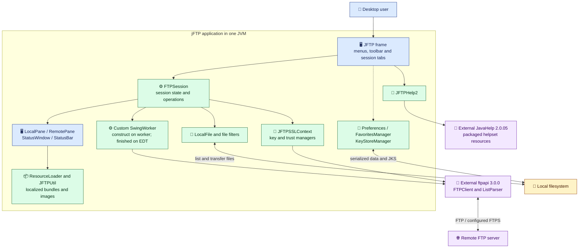
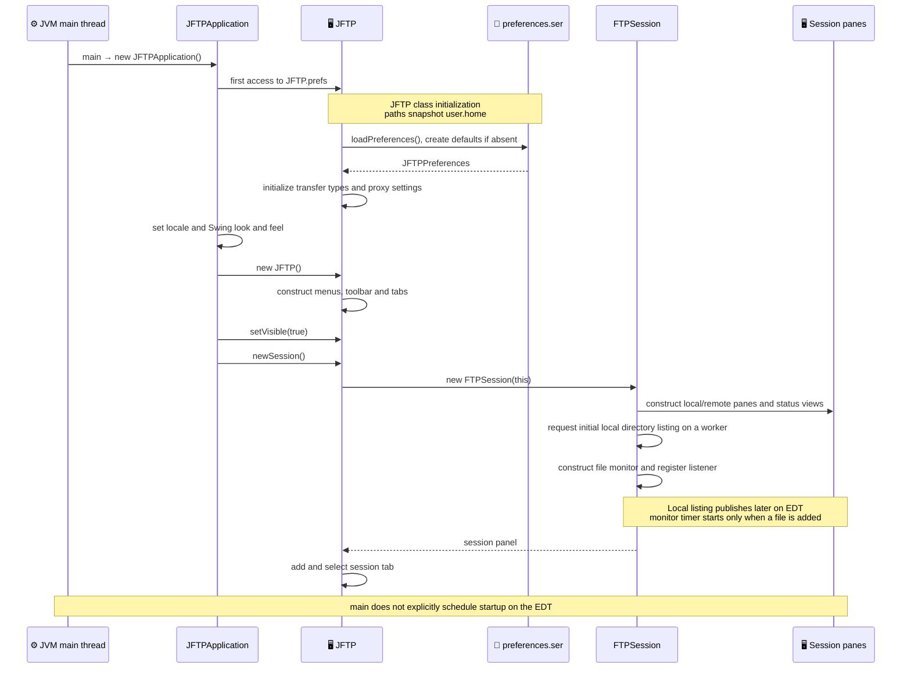
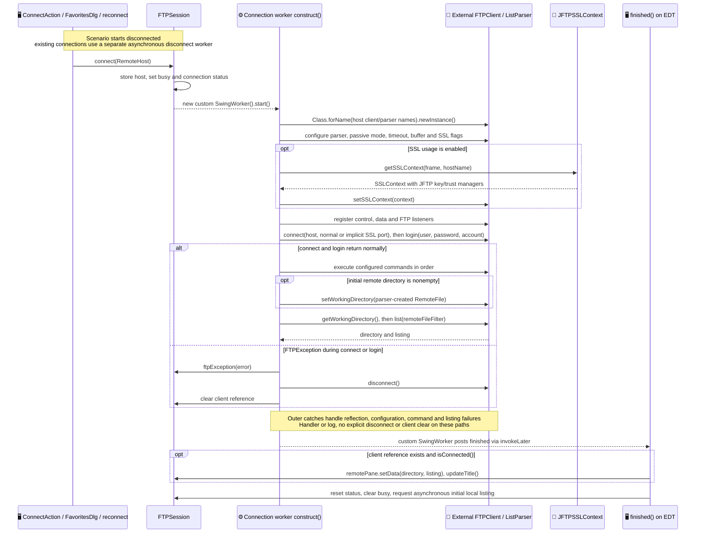
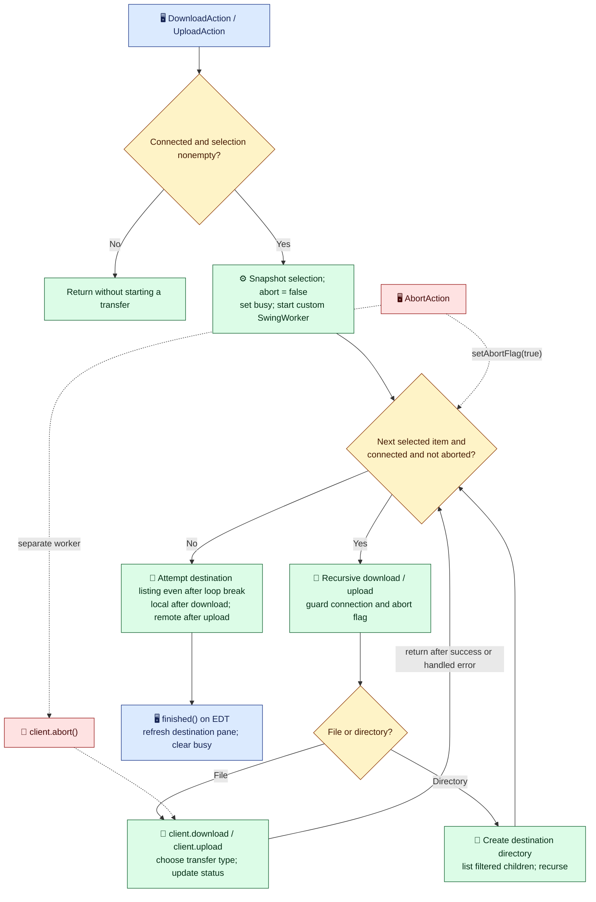
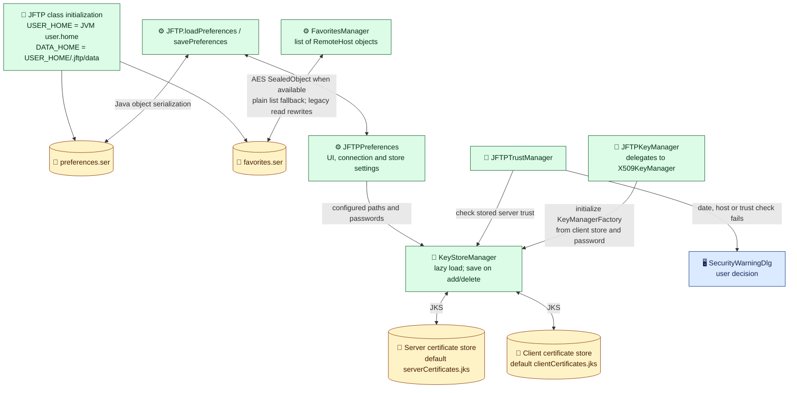

# jFTP architecture: source-checked views

Reviewed on 2026-10-15 at revision `efa2596e7a0522ba0cc9d2439b7702e30a0b5524`.
These diagrams document the existing Java/Swing application. They do not propose
a replacement architecture or certify its runtime correctness.

## Evidence and reading order

The starting points were the [RepoMap guide](../repo-maps/README.md) and selected
overview declarations, selected implementation sections of the
[full Repomix pack](../RepoMix/README.md), and the
[graph guide](../code-graph/README.md) with its
[architecture sketch](../code-graph/architecture.md).
Those snapshots name revision `cdc95025ac74098f129bfd9cdcd613fa6348c8d0`.
Comparing `src/main` and `pom.xml` with that revision found only `pom.xml` changed;
the diagrams use the current original sources and build descriptor.
The graph's exact-HEAD guard makes the saved graph unsuitable for current
traversal without refresh. Its documented gaps and rejected worker edge were
used as review prompts, rather than accepted as call relationships.

Before diagram drafting, a delegated **gpt-6-luna** review inspected original
startup, connection, transfer, worker, persistence and TLS files. Luna reviewed
all five drafts again; the final diagrams incorporate its corrections about
asynchronous local listing, dormant file monitoring and distinct error paths.
The primary agent checked those corrections against source. This is static
source review; neither reviewer ran the application for this documentation task.

Read the component view first, then the startup and connection sequences. The
transfer and persistence views expand specific responsibilities. Blue denotes
UI, green application code, purple external components, amber stored data or
decisions, and red cancellation. Explicit labels take precedence over color.
Solid component edges show dependencies or data access, not execution order;
the dotted frame-to-persistence edge groups indirect UI dependencies.

## 1. Components and external boundaries

The main frame owns session tabs; `FTPSession` combines UI coordination,
connection state and file operations. This is a component grouping, not a claim
of enforced architectural layers. `ftpapi` owns protocol/client/parser
implementations outside this checkout. JavaHelp is a separate dependency.
Maven copies five resource roots, including localized bundles, images and help.

[Mermaid source](../diagrams/jftp_architecture_01_flowchart_components.mmd) · [Rendered SVG](../diagrams/jftp_architecture_01_flowchart_components.svg)



Source: [JFTP frame and tabs](../../src/main/java/com/myjavaworld/jftp/JFTP.java#L119),
[session construction](../../src/main/java/com/myjavaworld/jftp/FTPSession.java#L110),
[dependencies and resource roots](../../pom.xml#L63),
[resource loading](../../src/main/java/com/myjavaworld/util/ResourceLoader.java#L29),
[JavaHelp integration](../../src/main/java/com/myjavaworld/jftp/JFTPHelp2.java#L40).

## 2. Startup and first session

Preferences initialize when `JFTP` is first referenced, before the frame
constructor runs. `USER_HOME` and `DATA_HOME` capture the JVM home at class
initialization. The initial local listing runs on a worker and can complete
after the session is returned and added to its tab. The file monitor is only
constructed here; its timer starts on the first file registered for monitoring.

[Mermaid source](../diagrams/jftp_architecture_02_sequence_startup.mmd) · [Rendered SVG](../diagrams/jftp_architecture_02_sequence_startup.svg)



Source: [entry point and ordering](../../src/main/java/com/myjavaworld/jftp/JFTPApplication.java#L32),
[static preferences and paths](../../src/main/java/com/myjavaworld/jftp/JFTP.java#L66),
[newSession](../../src/main/java/com/myjavaworld/jftp/JFTP.java#L148),
[local listing worker](../../src/main/java/com/myjavaworld/jftp/FTPSession.java#L346),
[monitor timer](../../src/main/java/com/myjavaworld/util/FileChangeMonitor.java#L45).

`main` does not explicitly dispatch frame construction onto the EDT. The
project's worker is `com.myjavaworld.gui.SwingWorker`, not the JDK class with
the same simple name: it creates a thread, runs `construct()` there, and posts
`finished()` with `SwingUtilities.invokeLater` after normal return from
`construct()`. That callback behavior does not establish thread safety of all
UI work or error paths.

## 3. Connect, authenticate and list

The sequence focuses on a disconnected session. `RemoteHost` supplies the
implementation class names; client/parser creation uses reflection. FTPS is
configured through the SSL context, key manager and trust manager. The diagram
shows application calls to `ftpapi`, without inventing its network internals.

[Mermaid source](../diagrams/jftp_architecture_03_sequence_connection.mmd) · [Rendered SVG](../diagrams/jftp_architecture_03_sequence_connection.svg)



Source: [connect worker and catches](../../src/main/java/com/myjavaworld/jftp/FTPSession.java#L593),
[ConnectAction caller](../../src/main/java/com/myjavaworld/jftp/actions/ConnectAction.java#L73),
[favorites caller](../../src/main/java/com/myjavaworld/jftp/FavoritesDlg.java#L232),
[custom worker](../../src/main/java/com/myjavaworld/gui/SwingWorker.java#L123),
[SSL context](../../src/main/java/com/myjavaworld/jftp/ssl/JFTPSSLContext.java#L37).

Important boundaries:

- For an existing connection, `connect()` asks for confirmation and calls
  `disconnect()`, which starts its own worker. It then starts connecting without
  awaiting that worker. `reconnect()` calls the same entry point. A sequential
  disconnect-completed-then-connect arrow would misrepresent the code.
- The inner `FTPException` catch covers connect/login, reports the failure,
  disconnects and clears `client`. Failures in reflection, configuration,
  commands or listing reach outer handlers/logging; those catches do not
  explicitly disconnect or clear the reference. A command failure skips later
  directory/list calls. The connected-client guard in `finished()` is not proof
  that the full initialization succeeded or that a listing was obtained.
- `finished()` resets status and busy state, then requests another asynchronous
  local listing. Busy-state clearing therefore does not describe all work as
  completed. Startup, callbacks and shared mutable session state need separate
  concurrency analysis before changes.

See [reconnect](../../src/main/java/com/myjavaworld/jftp/FTPSession.java#L701)
and [asynchronous disconnect](../../src/main/java/com/myjavaworld/jftp/FTPSession.java#L1495).

## 4. Standard upload/download and abort

Each standard transfer action takes the current pane selection and starts one
worker. The worker processes that selection serially; directory methods recurse
over filtered children. The directory box below represents that entire subtree.
No explicit application transfer queue was found in the inspected session and
action paths. This view does not cover every transfer variant.

[Mermaid source](../diagrams/jftp_architecture_04_flowchart_transfers.mmd) · [Rendered SVG](../diagrams/jftp_architecture_04_flowchart_transfers.svg)



Source: [download loop and recursion](../../src/main/java/com/myjavaworld/jftp/FTPSession.java#L707),
[upload loop and recursion](../../src/main/java/com/myjavaworld/jftp/FTPSession.java#L835),
[AbortAction](../../src/main/java/com/myjavaworld/jftp/actions/AbortAction.java#L53),
[session abort flag](../../src/main/java/com/myjavaworld/jftp/FTPSession.java#L1608).

File-transfer exceptions are caught and reported inside the operation, so an
error does not necessarily stop the selected-item loop. Download directory
recursion requires a non-null child listing. Upload catches directory-creation
errors and still proceeds to local child traversal. After the loop, download
collects a local listing; upload attempts a remote listing even after a break,
with separate error handling. Pane refresh is not proof of transfer success.

Abort sets a plain shared boolean and starts a separate worker calling
`client.abort()`. The dashed arrows denote concurrent cancellation requests;
they do not guarantee immediate stopping, visibility or rollback. The listing
and completion boxes describe normal returns and handled failures; unchecked
failures escaping `construct()` can prevent `finished()` from being posted.

## 5. Persistent state and certificate stores

Preferences and favorites are separate serialized files. Certificate stores
are separate JKS files whose paths and passwords come from preferences; users
can configure paths outside the default data directory. Trust failures can
lead to a user decision in the warning dialog. These are observed mechanisms,
not a security assessment or an endorsement of their defaults.

[Mermaid source](../diagrams/jftp_architecture_05_flowchart_persistence.mmd) · [Rendered SVG](../diagrams/jftp_architecture_05_flowchart_persistence.svg)



Source: [preference serialization](../../src/main/java/com/myjavaworld/jftp/JFTP.java#L512),
[favorite formats and migration](../../src/main/java/com/myjavaworld/jftp/FavoritesManager.java#L64),
[default store paths](../../src/main/java/com/myjavaworld/jftp/JFTPPreferences.java#L41),
[store loading and saving](../../src/main/java/com/myjavaworld/jftp/ssl/KeyStoreManager.java#L41),
[key-manager delegation](../../src/main/java/com/myjavaworld/jftp/ssl/JFTPKeyManager.java#L41),
[trust and warning decision](../../src/main/java/com/myjavaworld/jftp/ssl/JFTPTrustManager.java#L76).

The favorites reader accepts legacy plain lists and rewrites them on read.
Saving uses an AES `SealedObject` when a cipher is available, with a plain-list
fallback. Preference loading returns from `finally`, suppressing errors and
potentially returning defaults; favorites stream errors propagate. This
documentation introduces no format migration or behavior change.

## Verification and refresh

All five `.mmd` files passed Mermaid 12.2.0 parser validation.
All five were also rendered successfully to SVG and PNG with Mermaid CLI
12.0.0, Node 24.13.1 and local Chrome on Windows. The SVGs were parsed as XML;
PNG previews were inspected for readable labels, arrows and clipping. Fenced
Mermaid blocks match the standalone sources byte-for-byte after newline
normalization. Local Markdown links and line anchors were checked. Source and
output hashes are recorded in [the evidence manifest](jftp-architecture-2026-10-15.evidence.json).

The render command for each source was:

```powershell
mmdc -i docs/diagrams/<name>.mmd -o docs/diagrams/<name>.svg -b white -c docs/diagrams/jftp-architecture.theme.json -p <local-puppeteer-config.json>
```

The local Puppeteer config selected the installed Chrome executable; it contains
no project settings and is not versioned. PNG previews used the same arguments
and an ignored `target/diagram-validation/<name>.png` output path. This host
required a temporary Node preload selecting the JavaScript `realpath` APIs
because their native variants returned `EPERM`. pnpm also failed on symlink
creation; the working renderer used temporary `npm exec` with browser download
disabled. No project dependency or global tool installation was changed.
The sequence diagrams use commas or HTML line breaks instead of raw semicolons.
A raw semicolon separates sequence statements; use `#59;` when literal punctuation
is required in message text.
CLI usage follows the [Mermaid CLI documentation](https://github.com/mermaid-js/mermaid-cli#usage).

This documentation task did not run Maven, launch Swing or contact an FTP
service. It makes no new runtime claims. Existing startup evidence and its
limitations are documented separately in [minimal startup verification](../minimal-startup.md).
Protocol correctness, all callback threading, packaged execution and other
platforms remain outside these diagrams' verification.

The views intentionally omit applet/OS adapters, update checking, ZIP/unzip,
remote editing and most individual actions/dialogs. Refresh the affected
`.mmd`, rendered SVG and fenced block together after source changes. Recheck
original definitions, callers, reflection/configuration and failure paths;
refresh underlying maps only when their captured source changes. Rerender and
update the evidence manifest after review. A successful render validates syntax
and layout, not architecture semantics.
